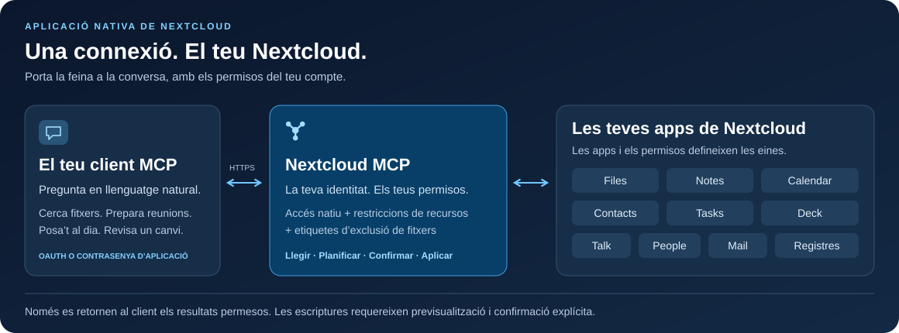

<!-- SPDX-FileCopyrightText: 2026 Sintax (Jhonatan Jaworski) <contato@sintax.tech> -->
<!-- SPDX-FileCopyrightText: 2026 MCP for Nextcloud contributors -->
<!-- SPDX-License-Identifier: AGPL-3.0-or-later -->
<!-- translation-source: README.md -->
<!-- translation-source-revision: 5beb2248a554cea171e7420ce93034571be15fec -->
<!-- translation-review: pending -->

**Traducció pendent de revisió humana:** aquesta pàgina és una traducció al català. Consulta la [pàgina original en anglès](README.md).

# Nextcloud MCP

### El teu Nextcloud, dins de la conversa.

Cerca fitxers, prepara una reunió, actualitza una tasca o posa't al dia del Talk des d'un assistent MCP. Una aplicació nativa de Nextcloud connecta el teu client amb les dades i els permisos que ja gestiones.

[](https://github.com/marcjoancr/mcp-for-nextcloud/actions/workflows/tests.yml?query=branch%3Amain)
[](https://github.com/marcjoancr/mcp-for-nextcloud/actions/workflows/quality.yml?query=branch%3Amain)
[](https://github.com/marcjoancr/mcp-for-nextcloud/actions/workflows/package.yml?query=branch%3Amain)
[](docs/ca/installation.md#requisits)
[](mcp/appinfo/info.xml)
[](LICENSE)

**[Primers passos](docs/ca/installation.md)** · **[Connecta el teu assistent](docs/ca/guides/clients.md)** · **[Explora les eines](docs/ca/reference/tools.md)** · [Documentació](docs/ca/README.md)

[English](README.md) · [Español](README.es.md) · **Català** · [Português (Brasil)](README.pt-BR.md) · [Português (Portugal)](README.pt-PT.md)



## Descobreix què pots fer

Són exemples de peticions, no transcripcions de clients enregistrades. Les accions disponibles depenen de les aplicacions habilitades, dels permisos concedits per l'administrador i dels teus permisos de Nextcloud.

| Demana al teu assistent… | Què proporciona Nextcloud MCP |
| --- | --- |
| «Troba la proposta del projecte i resumeix-la.» | Cerca per nom o contingut; llegeix text, PDF, DOCX i ODT; previsualitza imatges. |
| «Prepara'm per a les reunions de demà.» | Llegeix esdeveniments i notes, i després redacta o actualitza una nota amb confirmació prèvia. |
| «Quines tasques i targetes de Deck necessiten la meva atenció?» | Llista tasques i subtasques, consulta taulers i segueix les targetes vençudes. |
| «Posa'm al dia de les converses del Talk no llegides.» | Llista converses i llegeix missatges; envia una resposta amb confirmació prèvia. |
| «Substitueix aquest paràgraf de l'informe.» | Previsualitza el canvi de text; aplica l'edició confirmada amb les proteccions de còpia de seguretat configurades. |
| «Troba el fil de correu sobre la proposta i prepara una resposta.» | Cerca capçaleres en memòria cau, llegeix missatges propis sense marcar-los com a llegits i prepara un esborrany local sense enviar amb confirmació prèvia. |
| «Resumeix aquestes respostes del formulari i exporta aquesta pàgina a CSV.» | Llegeix resultats permesos, compta respostes per pregunta i previsualitza una exportació CSV limitada a Files. |

## Una connexió, onze mòduls

Els catàlegs defineixen fins a **112 eines**, incloses les eines de guia i estat, distribuïdes en **onze mòduls**. El descobriment només mostra les eines disponibles per al compte i la connexió seleccionada; tres eines de dependències de Deck també necessiten Nextcloud 34/35 i API de Deck compatibles.

| Mòdul | Capacitats |
| --- | --- |
| [Files](docs/ca/reference/tools/files.md) | Cerca noms, contingut i descripcions desades; lectura, edició, etiquetatge, pujada, organització, compartició i restauració de versions. Inclou enllaços només de pujada protegits amb contrasenya. Sense eina de supressió de fitxers. |
| [Notes](docs/ca/reference/tools/notes.md) | Cerca, creació i edició de notes, inclosos canvis parcials de text. |
| [Calendar](docs/ca/reference/tools/calendar.md) | Lectura i gestió d'esdeveniments mitjançant CalDAV natiu, amb invitacions explícites; consulta d'hores ocupades i intervals lliures comuns entre calendaris accessibles. |
| [Contacts](docs/ca/reference/tools/contacts.md) | Cerca i gestió de contactes conservant camps vCard desconeguts. |
| [Tasks](docs/ca/reference/tools/tasks.md) | Creació, actualització i compleció de tasques; gestió de subtasques dins d'una llista. |
| [Deck](docs/ca/reference/tools/deck.md) | Cerca i gestió de targetes, comentaris, compleció, persones assignades, etiquetes, enllaços natius de fitxers i dependències compatibles. |
| [Talk](docs/ca/reference/tools/talk.md) | Lectura, cerca i consulta de context de missatges; enviament de missatges o resums preparats per qui fa la crida, compartició de fitxers i creació de converses de grup. |
| [People](docs/ca/reference/tools/people.md) | Cerca de persones i grups abans de compartir o enviar missatges. |
| [Mail](docs/ca/reference/tools/mail.md) | Cerca de correu propi, lectura de missatges/fils/adjunts sense marcar-los com a llegits, desament d’adjunts a Files i gestió d’esborranys locals sense enviar. Sense enviament de correu. |
| [Forms](docs/ca/reference/tools/forms.md) | Lectura de formularis i resultats permesos, recompte de respostes per pàgina i exportació de pàgines de respostes a CSV a Files amb confirmació prèvia. |
| [Registres del servidor](docs/ca/reference/tools/logs.md) | Diagnòstic limitat de només lectura per a administradors i grups d'IT autoritzats; desactivat per defecte. |

## Integrat al teu Nextcloud

- **Una aplicació PHP nativa.** S'executa dins de Nextcloud amb un únic punt d'accés HTTPS. No cal administrar cap servei MCP separat ni entorn Node.js.
- **Els teus permisos a cada petició.** Les comprovacions natives d'accés de Nextcloud es combinen amb assignacions individuals d'eines, regles de grup, seleccions específiques de connexió, restriccions de recursos i etiquetes d'exclusió.
- **Previsualització abans de modificar dades.** Les crides d'escriptura retornen un pla si no es confirmen explícitament. L'assistent l'ha de mostrar i obtenir l'aprovació; el servidor no desa l'aprovació de la conversa.
- **Una interfície d'administració.** Consulta l'accés efectiu, assigna eines i restriccions de recursos, gestiona clients OAuth i revoca connexions.
- **OAuth o contrasenyes d'aplicació.** S'admeten identitats publicades de clients, un client local natiu i clients registrats per l'administrador. Altres clients compatibles poden fer servir HTTP Basic amb una contrasenya d'aplicació de Nextcloud.

El connector s'executa al teu servidor. Les dades retornades per les eines s'envien al client d'IA que triïs, subjectes a les seves polítiques de tractament i retenció. Comença pels [permisos](docs/ca/guides/permissions.md) i la [protecció de fitxers](docs/ca/guides/file-protection.md) per decidir a què pot accedir.

## Connecta-t'hi

1. **Instal·la el fork** a Nextcloud **33–35** amb PHP **8.4+**, amb un paquet construït a partir del codi revisat. Segueix la guia d'[instal·lació i actualització](docs/ca/installation.md).
2. **Habilita l'accés** a *Administració → Nextcloud MCP*: activa el servei, permet que l'usuari es connecti i assigna les eines que pot fer servir. Les escriptures comencen denegades. Mail, Forms i els registres del servidor requereixen permisos explícits; les eines noves comencen sense assignació.
3. **Connecta l'usuari** a *Configuració personal → Nextcloud MCP*, selecciona les eines permeses per a aquell client i afegeix aquest URL al client MCP:

   ```text
   https://cloud.example.com/apps/mcp/
   ```

4. **Demana la Guia d'eines** i prova una petició dels exemples anteriors. Segueix la [configuració de clients](docs/ca/guides/clients.md) per a OAuth, clients natius i contrasenyes d'aplicació. Consulta la [resolució de problemes](docs/ca/guides/troubleshooting.md) si fallen el descobriment o l'inici de sessió.

Substitueix l'origen de l'exemple pel teu URL de Nextcloud, inclòs qualsevol subdirectori d'instal·lació.

## Projecte i desenvolupament

Aquest és el fork mantingut independentment de [MCP for Cloud](https://github.com/sintax-tech/mcp-for-nextcloud), de Sintax (Jhonatan Jaworski). El manifest declara **2.7.0** i conserva l'identificador **`mcp`**. L'edició de la botiga d'aplicacions de Nextcloud pertany al projecte original; `occ app:install mcp` instal·la aquella edició. Fes servir el codi i el procediment d'instal·lació d'aquest fork si tries aquesta implementació.

Desenvolupa a `main` i adreça les sol·licituds de fusió a aquest fork. Comença per [Contributing (en anglès)](CONTRIBUTING.md), la [configuració de desenvolupament (en anglès)](docs/en/development/setup.md) i l'[arquitectura (en anglès)](docs/en/development/architecture-specification.md). Els requisits d'execució anteriors difereixen de la matriu de proves PHP 8.2–8.5 per a col·laboradors. L'acceptació d'una versió correspon a l'artefacte i l'entorn exactes que s'han provat.

[Registre de canvis (en anglès)](CHANGELOG.md) · [Informa d'un problema](https://github.com/marcjoancr/mcp-for-nextcloud/issues) · [Construeix un paquet (en anglès)](docs/en/development/packaging.md)

## Llicència

AGPL-3.0-or-later, amb el terme addicional d'atribució de la secció 7(b) a [NOTICE](NOTICE). La llicència completa és a [LICENSES/AGPL-3.0-or-later.txt](LICENSES/AGPL-3.0-or-later.txt). En redistribuir o oferir versions modificades a través d'una xarxa, conserva l'atribució de Sintax a la pàgina d'administració, a la documentació i als avisos de drets d'autor.

## Crèdits

El paquet inclou Smalot PdfParser, Symfony Polyfill Mbstring i l'autoloader de Composer. Consulta les versions, llicències, drets d'autor i dependències de desenvolupament a [THIRD-PARTY-NOTICES.md](mcp/THIRD-PARTY-NOTICES.md).

**Col·laboradors.** Gràcies a @NightDragon1 ([#5](https://github.com/sintax-tech/mcp-for-nextcloud/issues/5)) per la comprovació de visibilitat de l'arrel i a @matt-ek ([#4](https://github.com/sintax-tech/mcp-for-nextcloud/issues/4)) per l'informe que va donar lloc a l'auditoria d'etiquetes ocultes. Gràcies també a @matt-ek per la traducció alemanya de la interfície ([#10](https://github.com/sintax-tech/mcp-for-nextcloud/issues/10)) i a @Zegorax pels clients OAuth registrats per administradors ([#8](https://github.com/sintax-tech/mcp-for-nextcloud/issues/8), [#7](https://github.com/sintax-tech/mcp-for-nextcloud/issues/7)), i a @mturgeonferland per la contribució original de subtasques de Tasks ([#18](https://github.com/sintax-tech/mcp-for-nextcloud/pull/18)).

La documentació original també reconeix la contribució de Sintax/Jhonatan Jaworski a [XERJ Corpus Hub](https://hub.xerj.org/contributors/jhowjaw). Conservem aquest crèdit històric sense donar a entendre que XERJ hagi revisat aquest fork.

Developed by Sintax — https://sintax.tech
