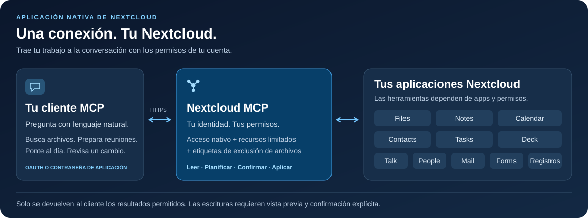

<!-- SPDX-FileCopyrightText: 2026 Sintax (Jhonatan Jaworski) <contato@sintax.tech> -->
<!-- SPDX-FileCopyrightText: 2026 MCP for Nextcloud contributors -->
<!-- SPDX-License-Identifier: AGPL-3.0-or-later -->
<!-- translation-source: README.md -->
<!-- translation-source-revision: 5beb2248a554cea171e7420ce93034571be15fec -->
<!-- translation-review: pending -->

**Traducción pendiente de revisión humana:** consulta la [versión en inglés](README.md).

# Nextcloud MCP

### Tu Nextcloud, dentro de la conversación.

Busca archivos, prepara una reunión, actualiza una tarea o ponte al día en Talk desde un asistente MCP. Una aplicación nativa de Nextcloud conecta tu cliente con los datos y permisos que ya gestionas.

[](https://github.com/marcjoancr/mcp-for-nextcloud/actions/workflows/tests.yml?query=branch%3Amain)
[](https://github.com/marcjoancr/mcp-for-nextcloud/actions/workflows/quality.yml?query=branch%3Amain)
[](https://github.com/marcjoancr/mcp-for-nextcloud/actions/workflows/package.yml?query=branch%3Amain)
[](docs/es/installation.md#requisitos)
[](mcp/appinfo/info.xml)
[](LICENSE)

**[Primeros pasos](docs/es/installation.md)** · **[Conecta tu asistente](docs/es/guides/clients.md)** · **[Explora las herramientas](docs/es/reference/tools.md)** · [Documentación](docs/es/README.md)

[English](README.md) · **Español** · [Català](README.ca.md) · [Português (Brasil)](README.pt-BR.md) · [Português (Portugal)](README.pt-PT.md)



## Mira qué puedes hacer

Son ejemplos de peticiones, no transcripciones de sesiones reales. Las acciones disponibles dependen de las aplicaciones activas, los permisos concedidos por la administración y tus propios permisos de Nextcloud.

| Pídele a tu asistente… | Qué aporta Nextcloud MCP |
| --- | --- |
| «Busca la propuesta del proyecto y resúmela». | Busca por nombre o contenido; lee texto, PDF, DOCX y ODT; muestra vistas previas de imágenes. |
| «Prepárame para las reuniones de mañana». | Lee eventos del calendario y notas; después redacta o actualiza una nota tras la confirmación. |
| «¿Qué tareas y tarjetas de Deck necesitan mi atención?». | Lista tareas y subtareas, consulta tableros y hace seguimiento de tarjetas vencidas. |
| «Ponme al día sobre las conversaciones sin leer de Talk». | Lista conversaciones y lee mensajes; envía una respuesta tras la confirmación. |
| «Sustituye este párrafo del informe». | Muestra el cambio de texto y aplica la edición confirmada con las protecciones de copia de seguridad configuradas. |
| «Busca el hilo de correo de la propuesta y prepara una respuesta». | Busca cabeceras en caché, lee mensajes propios sin marcarlos como leídos y prepara un borrador local sin enviar tras la confirmación. |
| «Resume estas respuestas del formulario y exporta esta página a CSV». | Lee resultados autorizados, cuenta respuestas por pregunta y muestra una exportación CSV acotada a Files para confirmar. |

## Una conexión, once módulos

Los catálogos definen hasta **112 herramientas**, incluidas la guía y las herramientas de estado. El descubrimiento solo muestra las disponibles para la cuenta y seleccionadas en la conexión; tres herramientas de dependencias de Deck requieren además API compatibles de Nextcloud 34/35 y Deck.

| Módulo | Capacidades |
| --- | --- |
| [Files](docs/es/reference/tools/files.md) | Buscar por nombre, contenido y descripciones guardadas; leer, editar, etiquetar, subir, organizar, compartir y restaurar versiones. Incluye enlaces de solo subida protegidos con contraseña. Sin herramienta para eliminar archivos. |
| [Notes](docs/es/reference/tools/notes.md) | Buscar, crear y editar notas, incluidos cambios parciales del texto. |
| [Calendar](docs/es/reference/tools/calendar.md) | Leer y gestionar eventos mediante CalDAV nativo, con invitaciones explícitas; consultar tiempos ocupados e intervalos libres comunes entre calendarios accesibles. |
| [Contacts](docs/es/reference/tools/contacts.md) | Buscar y gestionar contactos conservando los campos desconocidos del vCard. |
| [Tasks](docs/es/reference/tools/tasks.md) | Crear, actualizar y completar tareas; gestionar subtareas dentro de una lista. |
| [Deck](docs/es/reference/tools/deck.md) | Buscar y gestionar tarjetas, comentarios, finalización, personas asignadas, etiquetas, enlaces nativos a archivos y dependencias compatibles. |
| [Talk](docs/es/reference/tools/talk.md) | Leer, buscar y consultar el contexto de mensajes; enviar mensajes o resúmenes preparados por quien llama, compartir archivos y crear conversaciones de grupo. |
| [People](docs/es/reference/tools/people.md) | Buscar personas y grupos antes de compartir o enviar mensajes. |
| [Mail](docs/es/reference/tools/mail.md) | Buscar correo propio, leer mensajes/hilos/adjuntos sin marcarlos como leídos, guardar adjuntos en Files y gestionar borradores locales sin enviar. No envía correo. |
| [Forms](docs/es/reference/tools/forms.md) | Leer formularios y resultados permitidos, contar respuestas por página y exportar páginas de respuestas a CSV en Files tras la confirmación. |
| [Registros del servidor](docs/es/reference/tools/logs.md) | Diagnóstico acotado y de solo lectura para administradores y grupos de TI autorizados; desactivado por defecto. |

## Dentro de tu Nextcloud

- **Una aplicación PHP nativa.** Se ejecuta dentro de Nextcloud con un único endpoint HTTPS. No requiere gestionar un servicio MCP independiente ni un entorno Node.js.
- **Tus permisos en cada petición.** Las comprobaciones nativas de Nextcloud se combinan con asignaciones individuales de herramientas, reglas de grupo, selecciones por conexión, restricciones de recursos y etiquetas de exclusión.
- **Vista previa antes de cambiar datos.** Las llamadas de escritura devuelven un plan salvo que se confirmen explícitamente. El asistente debe mostrarlo y obtener aprobación; el servidor no guarda la aprobación de la conversación.
- **Una interfaz de administración.** Inspecciona el acceso efectivo, asigna herramientas y restricciones de recursos, gestiona clientes OAuth y revoca conexiones.
- **OAuth o contraseñas de aplicación.** Admite identidades de cliente publicadas, un cliente nativo para programas locales y clientes registrados por administradores. Otros clientes compatibles pueden usar HTTP Basic con una contraseña de aplicación de Nextcloud.

El conector se ejecuta en tu servidor. Los datos devueltos por las herramientas se envían al cliente de IA elegido, sujeto a sus propias políticas de tratamiento y conservación. Empieza por [permisos](docs/es/guides/permissions.md) y [protección de archivos](docs/es/guides/file-protection.md) para elegir a qué puede acceder.

## Conéctate

1. **Instala el fork** en Nextcloud **33–35** con PHP **8.4+**, mediante un paquete construido desde una revisión del código examinada. Sigue la guía de [instalación y actualizaciones](docs/es/installation.md).
2. **Habilita el acceso** en *Administración → Nextcloud MCP*: activa el servicio, permite al usuario conectarse y asigna las herramientas que pueda usar. La escritura empieza denegada. Mail, Forms y los registros requieren permisos explícitos; las herramientas nuevas empiezan sin asignar.
3. **Activa la conexión del usuario** en *Ajustes personales → Nextcloud MCP*, selecciona las herramientas permitidas para ese cliente y añade esta URL de servidor al cliente MCP:

   ```text
   https://cloud.example.com/apps/mcp/
   ```

4. **Pide la Guía de herramientas** y prueba una de las peticiones anteriores. Consulta la [configuración de clientes](docs/es/guides/clients.md) para OAuth, programas nativos y contraseñas de aplicación. Si falla el descubrimiento o el inicio de sesión, consulta [solución de problemas](docs/es/guides/troubleshooting.md).

Sustituye el origen del ejemplo por la URL de tu Nextcloud e incluye su subdirectorio de instalación si lo tiene.

## Proyecto y desarrollo

Este es el fork independiente de [MCP for Cloud](https://github.com/sintax-tech/mcp-for-nextcloud), de Sintax (Jhonatan Jaworski). El manifiesto declara la versión **2.7.0** y conserva el identificador **`mcp`**. La edición de la tienda de Nextcloud pertenece al proyecto original; `occ app:install mcp` instala esa edición. Usa el código de este fork y su procedimiento de instalación si eliges esta implementación.

El desarrollo parte de `main` y las solicitudes de incorporación se dirigen a este fork. Empieza por [Contribuir (en inglés)](CONTRIBUTING.md), la [preparación del entorno (en inglés)](docs/en/development/setup.md) y la [arquitectura (en inglés)](docs/en/development/architecture-specification.md). Los requisitos de ejecución anteriores difieren de la matriz de pruebas PHP 8.2–8.5 para colaboradores. La aceptación de una versión corresponde al artefacto y entorno concretos que se hayan probado.

[Registro de cambios (en inglés)](CHANGELOG.md) · [Notificar un problema](https://github.com/marcjoancr/mcp-for-nextcloud/issues) · [Construir un paquete (en inglés)](docs/en/development/packaging.md)

## Licencia

AGPL-3.0-or-later, con la condición adicional de atribución de la sección 7(b) que aparece en [NOTICE](NOTICE). La licencia completa está en [LICENSES/AGPL-3.0-or-later.txt](LICENSES/AGPL-3.0-or-later.txt). Al redistribuir o publicar en una red versiones modificadas, conserva la atribución de Sintax en la página de administración, la documentación y los avisos de copyright.

## Créditos

El paquete incluye Smalot PdfParser, Symfony Polyfill Mbstring y el cargador automático de Composer. Consulta las versiones, licencias, derechos de autor y dependencias de desarrollo en [THIRD-PARTY-NOTICES.md](mcp/THIRD-PARTY-NOTICES.md).

**Colaboradores.** Gracias a @NightDragon1 ([#5](https://github.com/sintax-tech/mcp-for-nextcloud/issues/5)) por la comprobación de visibilidad de la raíz y a @matt-ek ([#4](https://github.com/sintax-tech/mcp-for-nextcloud/issues/4)) por el informe que motivó la auditoría de etiquetas ocultas. Gracias también a @matt-ek por la traducción alemana de la interfaz ([#10](https://github.com/sintax-tech/mcp-for-nextcloud/issues/10)) y a @Zegorax por los clientes OAuth registrados por administradores ([#8](https://github.com/sintax-tech/mcp-for-nextcloud/issues/8), [#7](https://github.com/sintax-tech/mcp-for-nextcloud/issues/7)).


Jerarquía de tareas: [@mturgeonferland](https://github.com/sintax-tech/mcp-for-nextcloud/pull/18).

Sintax / Jhonatan Jaworski · [XERJ Corpus Hub](https://hub.xerj.org/contributors/jhowjaw). Este crédito histórico se conserva sin implicar que XERJ haya revisado este fork.

Developed by Sintax — https://sintax.tech
