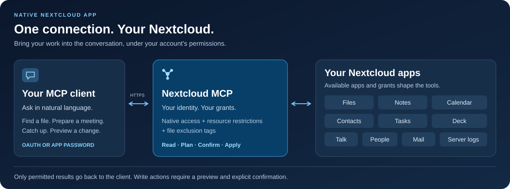

<!-- SPDX-FileCopyrightText: 2026 Sintax (Jhonatan Jaworski) <contato@sintax.tech> -->
<!-- SPDX-FileCopyrightText: 2026 MCP for Nextcloud contributors -->
<!-- SPDX-License-Identifier: AGPL-3.0-or-later -->

# Nextcloud MCP

### Your Nextcloud, in the conversation.

Search your files, prepare a meeting, update a task or catch up on Talk from an MCP assistant. A native Nextcloud app connects your client to the data and permissions you already manage.

[](https://github.com/marcjoancr/mcp-for-nextcloud/actions/workflows/tests.yml?query=branch%3Amain)
[](https://github.com/marcjoancr/mcp-for-nextcloud/actions/workflows/quality.yml?query=branch%3Amain)
[](https://github.com/marcjoancr/mcp-for-nextcloud/actions/workflows/package.yml?query=branch%3Amain)
[](docs/en/installation.md#requirements)
[](mcp/appinfo/info.xml)
[](LICENSE)

**[Get started](docs/en/installation.md)** · **[Connect your assistant](docs/en/guides/clients.md)** · **[Explore the tools](docs/en/reference/tools.md)** · [Documentation](docs/en/README.md)

**English** · [Español](README.es.md) · [Català](README.ca.md) · [Português (Brasil)](README.pt-BR.md) · [Português (Portugal)](README.pt-PT.md)



## See what you can do

These are example requests, not recorded client transcripts. Available actions depend on enabled apps, administrator grants and your own Nextcloud permissions.

| Ask your assistant… | What Nextcloud MCP provides |
| --- | --- |
| “Find the project proposal and summarize it.” | Search by filename or content; read text, PDF, DOCX and ODT; preview images. |
| “Prepare me for tomorrow's meetings.” | Read calendar events and notes, then draft or update a note after confirmation. |
| “Which tasks and Deck cards need my attention?” | List tasks and subtasks, inspect boards and follow up on overdue cards. |
| “Catch me up on unread Talk conversations.” | List conversations and read messages; send a reply after confirmation. |
| “Replace this paragraph in the report.” | Preview the text change; apply the confirmed edit with the configured backup safeguards. |
| “Show the unread counts for my mail folders.” | Read cached folder counters for your own Mail accounts, without fetching messages. |

## One connection, ten modules

The catalogs define up to **86 tools**, including the guide and status tools. Discovery shows only the tools the account may use; three Deck dependency tools additionally require compatible NC34/35 APIs.

| Module | Capabilities |
| --- | --- |
| [Files](docs/en/reference/tools/files.md) | Search, read, preview images, edit, upload, organize, share and restore versions. No file deletion tool. |
| [Notes](docs/en/reference/tools/notes.md) | Find, create and edit notes, including partial text changes. |
| [Calendar](docs/en/reference/tools/calendar.md) | Read and manage events through native CalDAV, including attendees and explicit invitations. |
| [Contacts](docs/en/reference/tools/contacts.md) | Search and manage contacts while preserving unfamiliar vCard fields. |
| [Tasks](docs/en/reference/tools/tasks.md) | Create, update and complete tasks; manage subtasks within a task list. |
| [Deck](docs/en/reference/tools/deck.md) | Manage boards, stacks, cards, assignees, labels, native file links and supported dependencies. |
| [Talk](docs/en/reference/tools/talk.md) | Read conversations, send messages, share files and create group conversations. |
| [People](docs/en/reference/tools/people.md) | Look up people and groups before sharing or messaging. |
| [Mail](docs/en/reference/tools/mail.md) | List owned accounts and cached folders/counters. Read-only; no message reading or sending. |
| [Server logs](docs/en/reference/tools/logs.md) | Bounded, read-only diagnostics for administrators and authorized IT groups; disabled by default. |

## Built into your Nextcloud

- **A native PHP app.** Runs inside Nextcloud with one HTTPS endpoint. No separate MCP service or Node.js runtime to operate.
- **Your permissions on every request.** Native Nextcloud access checks combine with per-user/group grants, optional resource restrictions and exclusion tags.
- **Preview before changing data.** Write calls return a plan unless explicitly confirmed. The assistant must show it and obtain approval; the server does not store conversational approval.
- **An administration interface.** Inspect effective access, choose permitted operations and resources, manage OAuth clients and revoke connections.
- **OAuth or app passwords.** Published client identities, a native local client and administrator-registered clients are supported. Other compatible clients can use HTTP Basic with a Nextcloud app password.

The connector runs on your server. Data returned by tools is sent to your chosen AI client, whose own processing and retention policies apply. Start with [permissions](docs/en/guides/permissions.md) and [file protection](docs/en/guides/file-protection.md) to choose what it can access.

## Get connected

1. **Install the fork** on Nextcloud **33–35** with PHP **8.4+**, using a package built from the reviewed source. Follow [installation and upgrades](docs/en/installation.md).
2. **Enable access** in *Administration → Nextcloud MCP*: turn on the service, allow the user to connect and choose their permissions. Writes start denied; Mail and server-log reading also require explicit access.
3. **Connect the user** in *Personal settings → Nextcloud MCP*, then add this server URL to the MCP client:

   ```text
   https://cloud.example.com/apps/mcp/
   ```

4. **Ask for the Tool guide**, then try a request from the examples above. Follow [client setup](docs/en/guides/clients.md) for OAuth, native and app-password configurations. See [troubleshooting](docs/en/guides/troubleshooting.md) if discovery or sign-in fails.

Replace the example origin with your own Nextcloud URL, including any installation subdirectory.

## Project and development

This is the independently maintained fork of [MCP for Cloud](https://github.com/sintax-tech/mcp-for-nextcloud) by Sintax (Jhonatan Jaworski). The application manifest declares **2.0.0** and retains app ID **`mcp`**. The Nextcloud App Store edition belongs to the original project; `occ app:install mcp` installs that edition. Use this fork's source and installation procedure when choosing this implementation.

Develop on `main` and target pull requests at this fork. Start with [Contributing](CONTRIBUTING.md), [development setup](docs/en/development/setup.md) and the [architecture](docs/en/development/architecture-specification.md). Runtime requirements above differ from the PHP 8.2–8.5 contributor test matrix. Release acceptance applies to the exact tested artifact and environment.

[Changelog](CHANGELOG.md) · [Report an issue](https://github.com/marcjoancr/mcp-for-nextcloud/issues) · [Build a package](docs/en/development/packaging.md)

## License

AGPL-3.0-or-later, with the additional section 7(b) attribution term in [NOTICE](NOTICE). The complete license is in [LICENSES/AGPL-3.0-or-later.txt](LICENSES/AGPL-3.0-or-later.txt). Preserve the Sintax attribution in the administration page, documentation and copyright notices when redistributing or making modified versions available over a network.

## Credits

The package includes Smalot PdfParser, Symfony Polyfill Mbstring and the Composer autoloader. See versions, licenses, copyright and development dependencies in [THIRD-PARTY-NOTICES.md](mcp/THIRD-PARTY-NOTICES.md).

**Contributors.** Thanks to @NightDragon1 ([#5](https://github.com/sintax-tech/mcp-for-nextcloud/issues/5)) for the root visibility check and to @matt-ek ([#4](https://github.com/sintax-tech/mcp-for-nextcloud/issues/4)) for the report behind the hidden-tags audit. Thanks also to @matt-ek for the German UI translation ([#10](https://github.com/sintax-tech/mcp-for-nextcloud/issues/10)) and @Zegorax for administrator-registered OAuth clients ([#8](https://github.com/sintax-tech/mcp-for-nextcloud/issues/8), [#7](https://github.com/sintax-tech/mcp-for-nextcloud/issues/7)), and @mturgeonferland for the original Tasks
subtask contribution ([#18](https://github.com/sintax-tech/mcp-for-nextcloud/pull/18)).

The upstream documentation also credits Sintax/Jhonatan Jaworski's contribution
to [XERJ Corpus Hub](https://hub.xerj.org/contributors/jhowjaw). This historical
credit is retained without implying that XERJ reviewed this fork.

Developed by Sintax — https://sintax.tech
