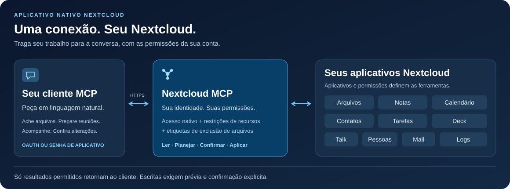

<!-- SPDX-FileCopyrightText: 2026 Sintax (Jhonatan Jaworski) <contato@sintax.tech> -->
<!-- SPDX-FileCopyrightText: 2026 MCP for Nextcloud contributors -->
<!-- SPDX-License-Identifier: AGPL-3.0-or-later -->

<!-- translation-source: README.md -->
<!-- translation-source-revision: 5beb2248a554cea171e7420ce93034571be15fec -->
<!-- translation-review: pending -->

> **Revisão humana pendente:** esta tradução aguarda revisão humana. Consulte [English](README.md).

# Nextcloud MCP

### Seu Nextcloud, na conversa.

Busque arquivos, prepare uma reunião, atualize uma tarefa ou acompanhe o Talk por um assistente MCP. Um aplicativo nativo Nextcloud conecta seu cliente aos dados e às permissões que você já gerencia.

[](https://github.com/marcjoancr/mcp-for-nextcloud/actions/workflows/tests.yml?query=branch%3Amain)
[](https://github.com/marcjoancr/mcp-for-nextcloud/actions/workflows/quality.yml?query=branch%3Amain)
[](https://github.com/marcjoancr/mcp-for-nextcloud/actions/workflows/package.yml?query=branch%3Amain)
[](docs/pt-BR/installation.md#requisitos)
[](mcp/appinfo/info.xml)
[](LICENSE)

**[Primeiros passos](docs/pt-BR/installation.md)** · **[Conecte seu assistente](docs/pt-BR/guides/clients.md)** · **[Explore as ferramentas](docs/pt-BR/reference/tools.md)** · [Documentação](docs/pt-BR/README.md)

[English](README.md) · [Español](README.es.md) · [Català](README.ca.md) · **Português (Brasil)** · [Português (Portugal)](README.pt-PT.md)



## Veja o que você pode fazer

Estas são solicitações de exemplo, não transcrições gravadas de clientes. As ações disponíveis dependem dos aplicativos habilitados, das permissões concedidas pelo administrador e das suas próprias permissões Nextcloud.

| Peça ao seu assistente… | O que o Nextcloud MCP oferece |
| --- | --- |
| “Encontre a proposta do projeto e faça um resumo.” | Buscar por nome ou conteúdo; ler texto, PDF, DOCX e ODT; visualizar imagens. |
| “Prepare-me para as reuniões de amanhã.” | Ler eventos do calendário e notas, depois criar ou atualizar uma nota após confirmação. |
| “Quais tarefas e cards do Deck precisam da minha atenção?” | Listar tarefas e subtarefas, inspecionar quadros e acompanhar cards atrasados. |
| “Resuma as conversas não lidas do Talk.” | Listar conversas e ler mensagens; enviar resposta após confirmação. |
| “Substitua este parágrafo no relatório.” | Visualizar a alteração de texto; aplicar a edição confirmada com as proteções de backup configuradas. |
| “Encontre a conversa de e-mail sobre a proposta e prepare uma resposta.” | Buscar cabeçalhos em cache, ler mensagens próprias sem marcá-las como lidas e preparar um rascunho local não enviado após confirmação. |
| “Resuma estas respostas de formulário e exporte esta página para CSV.” | Ler resultados permitidos, contar respostas por pergunta e visualizar uma exportação CSV limitada para Files. |

## Uma conexão, onze módulos

Os catálogos definem até **112 ferramentas**, incluindo guia e status, em **onze módulos**. A descoberta mostra apenas as ferramentas disponíveis para a conta e a conexão selecionada; três ferramentas de dependência do Deck exigem também APIs compatíveis de Nextcloud 34/35 e Deck.

| Módulo | Recursos |
| --- | --- |
| [Arquivos](docs/pt-BR/reference/tools/files.md) | Buscar nomes, conteúdo e descrições salvas; ler, editar, aplicar etiquetas, enviar, organizar, compartilhar e restaurar versões. Inclui links protegidos por senha somente para upload. Não há ferramenta de exclusão de arquivos. |
| [Notas](docs/pt-BR/reference/tools/notes.md) | Encontrar, criar e editar notas, inclusive alterações parciais de texto. |
| [Calendário](docs/pt-BR/reference/tools/calendar.md) | Ler e gerenciar eventos pelo CalDAV nativo, inclusive convites explícitos; verificar horários ocupados e intervalos livres em comum nos calendários acessíveis. |
| [Contatos](docs/pt-BR/reference/tools/contacts.md) | Buscar e gerenciar contatos preservando campos vCard desconhecidos. |
| [Tarefas](docs/pt-BR/reference/tools/tasks.md) | Criar, atualizar e concluir tarefas; gerenciar subtarefas na mesma lista. |
| [Deck](docs/pt-BR/reference/tools/deck.md) | Buscar e gerenciar cards, comentários, conclusão, responsáveis, etiquetas, vínculos nativos a arquivos e dependências suportadas. |
| [Talk](docs/pt-BR/reference/tools/talk.md) | Ler, buscar e inspecionar o contexto de mensagens; enviar mensagens ou resumos preparados pelo solicitante, compartilhar arquivos e criar conversas de grupo. |
| [Pessoas](docs/pt-BR/reference/tools/people.md) | Encontrar pessoas e grupos antes de compartilhar ou enviar mensagens. |
| [Mail](docs/pt-BR/reference/tools/mail.md) | Buscar e-mails próprios, ler mensagens/conversas/anexos sem marcá-los como lidos, salvar anexos em Files e gerenciar rascunhos locais não enviados. Sem envio de mensagens. |
| [Forms](docs/pt-BR/reference/tools/forms.md) | Ler formulários e resultados permitidos, contar respostas por página e exportar páginas de respostas para CSV em Files após confirmação. |
| [Logs do servidor](docs/pt-BR/reference/tools/logs.md) | Diagnóstico limitado e somente leitura para administradores e grupos de TI autorizados; desativado por padrão. |

## Integrado ao seu Nextcloud

- **Aplicativo PHP nativo.** Executa dentro do Nextcloud com um único endpoint HTTPS. Não há serviço MCP separado nem runtime Node.js para operar.
- **Suas permissões em cada solicitação.** Verificações nativas de acesso Nextcloud se combinam com atribuições individuais de ferramentas, regras de grupo, seleções por conexão, restrições de recursos e etiquetas de exclusão.
- **Prévia antes de alterar dados.** Chamadas de escrita retornam um plano, salvo confirmação explícita. O assistente deve apresentá-lo e obter aprovação; o servidor não armazena aprovação conversacional.
- **Interface de administração.** Inspecione o acesso efetivo, atribua ferramentas e restrições de recursos, gerencie clientes OAuth e revogue conexões.
- **OAuth ou senhas de aplicativo.** Há suporte a identidades de clientes publicadas, um cliente local nativo e clientes registrados pelo administrador. Outros clientes compatíveis podem usar HTTP Basic com uma senha de aplicativo Nextcloud.

O conector executa no seu servidor. Dados retornados pelas ferramentas são enviados ao cliente de IA escolhido, sujeito às suas próprias políticas de processamento e retenção. Comece por [permissões](docs/pt-BR/guides/permissions.md) e [proteção de arquivos](docs/pt-BR/guides/file-protection.md) para escolher o que ele pode acessar.

## Conecte-se

1. **Instale o fork** no Nextcloud **33–35** com PHP **8.4+**, usando um pacote gerado do código-fonte verificado. Siga [instalação e atualizações](docs/pt-BR/installation.md).
2. **Habilite o acesso** em *Administração → Nextcloud MCP*: ative o serviço, permita a conexão do usuário e atribua as ferramentas que ele pode usar. Escritas começam negadas. Acesso a Mail, Forms e logs exige permissões explícitas; novas ferramentas começam sem atribuição.
3. **Conecte o usuário** em *Configurações pessoais → Nextcloud MCP*, selecione as ferramentas permitidas para esse cliente e adicione esta URL ao cliente MCP:

   ```text
   https://cloud.example.com/apps/mcp/
   ```

4. **Peça o Guia das ferramentas** e experimente uma solicitação dos exemplos acima. Siga a [configuração de clientes](docs/pt-BR/guides/clients.md) para OAuth, cliente nativo e senhas de aplicativo. Consulte [solução de problemas](docs/pt-BR/guides/troubleshooting.md) se a descoberta ou o login falhar.

Substitua a origem de exemplo pela URL do seu Nextcloud, incluindo o subdiretório da instalação, se houver.

## Projeto e desenvolvimento

Este é o fork mantido independentemente de [MCP for Cloud](https://github.com/sintax-tech/mcp-for-nextcloud), de Sintax (Jhonatan Jaworski). O manifesto declara **2.7.0** e mantém o identificador **`mcp`**. A edição da loja Nextcloud pertence ao projeto original; `occ app:install mcp` instala essa edição. Use o código-fonte e o procedimento de instalação deste fork ao escolher esta implementação.

Desenvolva em `main` e direcione pull requests a este fork. Comece por [Como contribuir (em inglês)](CONTRIBUTING.md), [preparação do ambiente (em inglês)](docs/en/development/setup.md) e [arquitetura (em inglês)](docs/en/development/architecture-specification.md). Os requisitos de execução acima diferem da matriz de testes PHP 8.2–8.5 para colaboradores. A aceitação de uma versão se aplica ao artefato e ambiente exatos testados.

[Histórico de versões (em inglês)](CHANGELOG.md) · [Relatar um problema](https://github.com/marcjoancr/mcp-for-nextcloud/issues) · [Gerar um pacote (em inglês)](docs/en/development/packaging.md)

## Licença

AGPL-3.0-or-later, com o termo adicional de atribuição da seção 7(b) no [NOTICE](NOTICE). O texto integral da licença está em [LICENSES/AGPL-3.0-or-later.txt](LICENSES/AGPL-3.0-or-later.txt). Preserve o crédito à Sintax na administração, na documentação e nos avisos de autoria ao redistribuir ou oferecer versões modificadas pela rede.

## Créditos

O pacote inclui Smalot PdfParser, Symfony Polyfill Mbstring e o autoloader do Composer. Consulte versões, licenças, autoria e dependências de desenvolvimento em [THIRD-PARTY-NOTICES.md](mcp/THIRD-PARTY-NOTICES.md).

**Contribuidores.** Agradecimento a @NightDragon1 ([#5](https://github.com/sintax-tech/mcp-for-nextcloud/issues/5)) pela checagem de visibilidade da raiz e a @matt-ek ([#4](https://github.com/sintax-tech/mcp-for-nextcloud/issues/4)) pelo relato que motivou a auditoria da ocultação por tags. Agradecemos também a @matt-ek pela tradução alemã da interface ([#10](https://github.com/sintax-tech/mcp-for-nextcloud/issues/10)) e a @Zegorax pelos clientes OAuth registrados por administradores ([#8](https://github.com/sintax-tech/mcp-for-nextcloud/issues/8), [#7](https://github.com/sintax-tech/mcp-for-nextcloud/issues/7)).


Agradecemos a @mturgeonferland pela contribuição original de subtarefas de Tasks ([#18](https://github.com/sintax-tech/mcp-for-nextcloud/pull/18)).

A documentação original também credita a contribuição de Sintax/Jhonatan Jaworski ao [XERJ Corpus Hub](https://hub.xerj.org/contributors/jhowjaw). Esse crédito histórico é preservado sem sugerir que XERJ revisou este fork.

Developed by Sintax — https://sintax.tech
