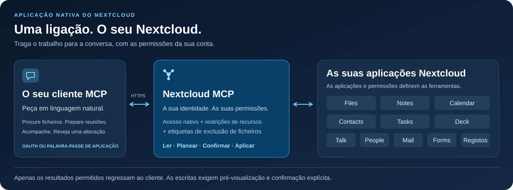

<!-- SPDX-FileCopyrightText: 2026 Sintax (Jhonatan Jaworski) <contato@sintax.tech> -->
<!-- SPDX-FileCopyrightText: 2026 MCP for Nextcloud contributors -->
<!-- SPDX-License-Identifier: AGPL-3.0-or-later -->
<!-- translation-source: README.md -->
<!-- translation-source-revision: 5beb2248a554cea171e7420ce93034571be15fec -->
<!-- translation-review: pending -->

> **Revisão humana pendente:** esta tradução ainda precisa de revisão humana. Consulte [English](README.md).

# Nextcloud MCP

### O seu Nextcloud, na conversa.

Pesquise os seus ficheiros, prepare uma reunião, atualize uma tarefa ou ponha as conversas do Talk em dia com um assistente MCP. Uma aplicação nativa do Nextcloud liga o seu cliente aos dados e às permissões que já gere.

[](https://github.com/marcjoancr/mcp-for-nextcloud/actions/workflows/tests.yml?query=branch%3Amain)
[](https://github.com/marcjoancr/mcp-for-nextcloud/actions/workflows/quality.yml?query=branch%3Amain)
[](https://github.com/marcjoancr/mcp-for-nextcloud/actions/workflows/package.yml?query=branch%3Amain)
[](docs/pt-PT/installation.md#requisitos)
[](mcp/appinfo/info.xml)
[](LICENSE)

**[Primeiros passos](docs/pt-PT/installation.md)** · **[Ligar o seu assistente](docs/pt-PT/guides/clients.md)** · **[Explorar as ferramentas](docs/pt-PT/reference/tools.md)** · [Documentação](docs/pt-PT/README.md)

[English](README.md) · [Español](README.es.md) · [Català](README.ca.md) · [Português (Brasil)](README.pt-BR.md) · **Português (Portugal)**



## Veja o que pode fazer

Estes pedidos são exemplos, não transcrições de sessões reais. As ações disponíveis dependem das aplicações ativadas, das permissões concedidas pelo administrador e das suas próprias permissões no Nextcloud.

| Peça ao seu assistente… | O que o Nextcloud MCP disponibiliza |
| --- | --- |
| «Encontra a proposta do projeto e resume-a.» | Pesquisa por nome ou conteúdo; leitura de texto, PDF, DOCX e ODT; pré-visualização de imagens. |
| «Prepara-me para as reuniões de amanhã.» | Leitura de eventos e notas, seguida da criação ou atualização de uma nota após confirmação. |
| «Que tarefas e cartões do Deck precisam da minha atenção?» | Listagem de tarefas e subtarefas, consulta de quadros e acompanhamento de cartões em atraso. |
| «Põe-me a par das conversas por ler no Talk.» | Listagem de conversas e leitura de mensagens; envio de uma resposta após confirmação. |
| «Substitui este parágrafo no relatório.» | Pré-visualização da alteração; aplicação da edição confirmada com as salvaguardas de cópia de segurança configuradas. |
| «Encontra a conversa de correio sobre a proposta e prepara uma resposta.» | Pesquisa de cabeçalhos em cache, leitura de mensagens próprias sem as marcar como lidas e preparação de um rascunho local não enviado após confirmação. |
| «Resume estas respostas do formulário e exporta esta página para CSV.» | Leitura de resultados permitidos, contagem de respostas por pergunta e pré-visualização de uma exportação CSV limitada para Files. |

## Uma ligação, onze módulos

Os catálogos definem até **112 ferramentas**, incluindo o guia e as ferramentas de estado. A descoberta só apresenta ferramentas disponíveis para a conta e selecionadas na ligação; três ferramentas de dependências do Deck exigem ainda APIs compatíveis do Nextcloud 34/35 e Deck.

| Módulo | Funcionalidades |
| --- | --- |
| [Ficheiros](docs/pt-PT/reference/tools/files.md) | Pesquisar nomes, conteúdo e descrições guardadas; ler, editar, etiquetar, carregar, organizar, partilhar e restaurar versões. Inclui ligações protegidas por palavra-passe apenas para carregamento. Sem ferramenta de eliminação de ficheiros. |
| [Notas](docs/pt-PT/reference/tools/notes.md) | Encontrar, criar e editar notas, incluindo alterações parciais de texto. |
| [Calendário](docs/pt-PT/reference/tools/calendar.md) | Ler e gerir eventos através do CalDAV nativo, incluindo convites explícitos; verificar períodos ocupados e intervalos livres comuns em calendários acessíveis. |
| [Contactos](docs/pt-PT/reference/tools/contacts.md) | Pesquisar e gerir contactos, preservando campos vCard desconhecidos. |
| [Tarefas](docs/pt-PT/reference/tools/tasks.md) | Criar, atualizar e concluir tarefas; gerir subtarefas na mesma lista. |
| [Deck](docs/pt-PT/reference/tools/deck.md) | Pesquisar e gerir cartões, comentários, conclusão, responsáveis, etiquetas, associações nativas a ficheiros e dependências suportadas. |
| [Talk](docs/pt-PT/reference/tools/talk.md) | Ler, pesquisar e consultar o contexto de mensagens; enviar mensagens ou resumos preparados por quem chama, partilhar ficheiros e criar conversas de grupo. |
| [Pessoas](docs/pt-PT/reference/tools/people.md) | Procurar pessoas e grupos antes de partilhar ou enviar mensagens. |
| [Mail](docs/pt-PT/reference/tools/mail.md) | Pesquisar correio próprio, ler mensagens/conversas/anexos sem marcar como lidos, guardar anexos em Files e gerir rascunhos locais não enviados. Sem envio. |
| [Forms](docs/pt-PT/reference/tools/forms.md) | Ler formulários e resultados permitidos, contar respostas por página e exportar páginas para CSV em Files após confirmação. |
| [Registos do servidor](docs/pt-PT/reference/tools/logs.md) | Diagnóstico limitado e apenas de leitura para administradores e grupos de TI autorizados; desativado por predefinição. |

## Integrado no seu Nextcloud

- **Uma aplicação PHP nativa.** Funciona dentro do Nextcloud com um único ponto de acesso HTTPS. Sem serviço MCP separado ou ambiente Node.js para gerir.
- **As suas permissões em cada pedido.** As verificações nativas do Nextcloud combinam-se com atribuições individuais de ferramentas, regras de grupos, seleções por ligação, restrições de recursos e etiquetas de exclusão.
- **Pré-visualização antes de alterar dados.** As chamadas de escrita devolvem um plano, salvo confirmação explícita. O assistente deve mostrá-lo e obter aprovação; o servidor não guarda a aprovação dada na conversa.
- **Uma interface de administração.** Consulte o acesso efetivo, atribua ferramentas e restrições de recursos, gira clientes OAuth e revogue ligações.
- **OAuth ou palavras-passe de aplicação.** Suporta identidades publicadas de clientes, um cliente local nativo e clientes registados pelo administrador. Outros clientes compatíveis podem utilizar HTTP Basic com uma palavra-passe de aplicação do Nextcloud.

O conector funciona no seu servidor. Os dados devolvidos pelas ferramentas são enviados ao cliente de IA que escolher, sujeito às suas próprias políticas de tratamento e retenção. Comece pelas [permissões](docs/pt-PT/guides/permissions.md) e pela [proteção de ficheiros](docs/pt-PT/guides/file-protection.md) para escolher o que pode ser consultado.

## Estabelecer a ligação

1. **Instale o fork** no Nextcloud **33–35** com PHP **8.4+**, usando um pacote construído a partir do código-fonte revisto. Siga [instalação e atualizações](docs/pt-PT/installation.md).
2. **Ative o acesso** em *Administração → Nextcloud MCP*: ative o serviço, permita que o utilizador se ligue e atribua as ferramentas que pode utilizar. As escritas começam recusadas. Mail, Forms e o acesso aos registos do servidor exigem permissões explícitas; novas ferramentas começam sem atribuição.
3. **Ligue o utilizador** em *Definições pessoais → Nextcloud MCP*, selecione as ferramentas permitidas para esse cliente e adicione este URL do servidor ao cliente MCP:

   ```text
   https://cloud.example.com/apps/mcp/
   ```

4. **Peça o Guia das ferramentas** e experimente um dos pedidos acima. Siga a [configuração de clientes](docs/pt-PT/guides/clients.md) para OAuth, cliente nativo e palavras-passe de aplicação. Consulte a [resolução de problemas](docs/pt-PT/guides/troubleshooting.md) se a descoberta ou o início de sessão falhar.

Substitua a origem do exemplo pelo URL do seu Nextcloud, incluindo qualquer subdiretório de instalação.

## Projeto e desenvolvimento

Este é o fork mantido de forma independente de [MCP for Cloud](https://github.com/sintax-tech/mcp-for-nextcloud), de Sintax (Jhonatan Jaworski). O manifesto declara **2.7.0** e mantém o identificador **`mcp`**. A edição da Nextcloud App Store pertence ao projeto original; `occ app:install mcp` instala essa edição. Use o código-fonte e o procedimento de instalação deste fork ao escolher esta implementação.

Desenvolva em `main` e dirija os pedidos de integração a este fork. Comece por [Como contribuir (em inglês)](CONTRIBUTING.md), [preparação do desenvolvimento (em inglês)](docs/en/development/setup.md) e [arquitetura (em inglês)](docs/en/development/architecture-specification.md). Os requisitos de execução acima diferem da matriz de testes PHP 8.2–8.5 para contribuidores. A aceitação de uma versão aplica-se ao artefacto e ambiente exatos que foram testados.

[Registo de alterações (em inglês)](CHANGELOG.md) · [Comunicar um problema](https://github.com/marcjoancr/mcp-for-nextcloud/issues) · [Construir um pacote (em inglês)](docs/en/development/packaging.md)

## Licença

AGPL-3.0-or-later, com a cláusula adicional de atribuição da secção 7(b) em [NOTICE](NOTICE). A licença completa encontra-se em [LICENSES/AGPL-3.0-or-later.txt](LICENSES/AGPL-3.0-or-later.txt). Preserve a atribuição à Sintax na página de administração, na documentação e nos avisos de direitos de autor ao redistribuir ou disponibilizar versões modificadas numa rede.

## Créditos

O pacote inclui Smalot PdfParser, Symfony Polyfill Mbstring e o autoloader do Composer. Consulte as versões, licenças, direitos de autor e dependências de desenvolvimento em [THIRD-PARTY-NOTICES.md](mcp/THIRD-PARTY-NOTICES.md).

**Contribuidores.** Agradecemos a @NightDragon1 ([#5](https://github.com/sintax-tech/mcp-for-nextcloud/issues/5)) pela verificação da visibilidade da raiz e a @matt-ek ([#4](https://github.com/sintax-tech/mcp-for-nextcloud/issues/4)) pelo relatório que esteve na origem da auditoria de etiquetas ocultas. Agradecemos também a @matt-ek pela tradução alemã da interface ([#10](https://github.com/sintax-tech/mcp-for-nextcloud/issues/10)) e a @Zegorax pelos clientes OAuth registados por administradores ([#8](https://github.com/sintax-tech/mcp-for-nextcloud/issues/8), [#7](https://github.com/sintax-tech/mcp-for-nextcloud/issues/7)). Agradecemos a @mturgeonferland pela contribuição original de subtarefas de Tasks ([#18](https://github.com/sintax-tech/mcp-for-nextcloud/pull/18)).

A documentação original também reconhece a contribuição de Sintax/Jhonatan Jaworski para o [XERJ Corpus Hub](https://hub.xerj.org/contributors/jhowjaw). Este crédito histórico é preservado sem sugerir que o XERJ tenha revisto este fork.

Developed by Sintax — https://sintax.tech
