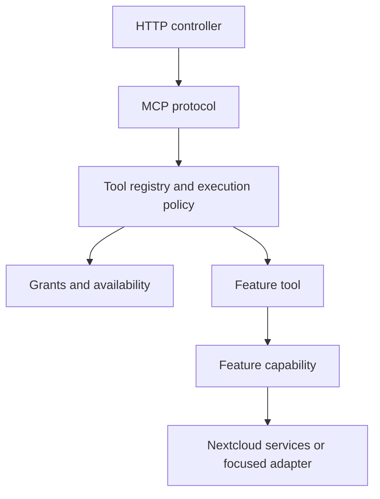

<!-- SPDX-FileCopyrightText: 2026 MCP for Nextcloud contributors -->
<!-- SPDX-License-Identifier: AGPL-3.0-or-later -->

# Developer experience and modular architecture specification

Status: Files (23 tools), Deck (13), Talk (8), Calendar (7), Contacts (6), Tasks (7),
Notes (7), People (1) and Logs (2) are implemented by capabilities: 74 tools across
nine modules, including shared DAV and direct consumers. See the
[Files report](plans/2026-10-16-files-capability-migration-report.md) and
[Deck report](plans/2026-10-16-deck-capability-migration-report.md) and
[Talk report](plans/2026-10-16-talk-capability-migration-report.md) and
[DAV migration report](plans/2026-10-16-calendar-dav-capability-migration-report.md) and
[Notes migration report](plans/2026-10-16-notes-capability-migration-report.md) and
[People migration report](plans/2026-10-16-people-capability-migration-report.md) and
[Logs migration report](plans/2026-10-17-logs-capability-migration-report.md) for validation
and outstanding integration gates.

Date: 2026-10-16. Local closure updated: 2026-10-17.

Baseline examined: `a1a7911cc72dcf2487d17e06e23edfa89b0ecf92` (upstream 1.0.8).
The capability, shared infrastructure, DevEx, administration JavaScript and
README/docs migrations are locally implemented. Translations remain pending human
review. The [local closure report](plans/2026-10-17-local-technical-closure-report.md)
is the consolidated status, including validation limits and the separately required
integration with upstream 1.1.0; historical reports describe their own revisions.

Related documents: [Files pilot implementation plan](plans/2026-10-16-files-pilot.md),
[Files capability migration plan](plans/2026-10-16-files-capability-migration.md),
[Deck capability migration plan](plans/2026-10-16-deck-capability-migration.md),
reviewed [Talk capability migration plan](plans/2026-10-16-talk-capability-migration.md),
completed [Calendar, DAV, Contacts and Tasks migration plan](plans/2026-10-16-calendar-dav-capability-migration.md),
completed [Notes capability migration plan](plans/2026-10-16-notes-capability-migration.md),
completed [People capability migration plan](plans/2026-10-16-people-capability-migration.md),
completed [Logs capability migration plan](plans/2026-10-17-logs-capability-migration.md),
and the completed [shared MCP infrastructure migration plan](plans/2026-10-17-shared-mcp-infrastructure-migration.md).

## 1. Intent and scope

Make the project easy to navigate, extend, test, and maintain as more contributors
and MCP tools are added. A contributor should find an operation's definition and
entry points together, understand its dependencies from its constructor, and test
it without constructing unrelated functionality.

This specification records the agreed architecture, English source/documentation
policy and incremental migration. The read/edit pilot was implemented first; the
user then authorized the complete Files, Deck, Talk, Calendar/DAV/Contacts/Tasks, Notes, People and Logs
capability plans. These modules and their direct consumers are the completed
implementation boundary. The shared MCP infrastructure migration is also implemented;
see its [execution report](plans/2026-10-17-shared-mcp-infrastructure-migration-report.md).
Developer tooling, administration JavaScript and documentation migrations are also
implemented, as recorded in the consolidated closure report. Publishing,
pull requests and deployment require their own authorization.

### Requirements

- G1: Organize functionality into cohesive modules and capabilities.
- G2: Keep policy enforcement shared and mandatory at public entry points.
- G3: Preserve observable behavior during structural migration.
- G4: Make dependencies explicit and keep focused tests inexpensive to assemble.
- G5: Keep code, identifiers, comments, PHPDoc, and technical source documentation in English.
- G6: Keep user-facing messages localized through the existing translation system.
- G7: Maintain project documentation under `docs/`, with English as its reference language and explicit translations.
- G8: Migrate incrementally and evaluate a read/write pilot before expanding the pattern.

### Non-goals

Do not introduce microservices, a separate MCP server, a new runtime framework,
a frontend framework, a generic workflow engine, or automatic filesystem-based
tool discovery. Do not impose a DTO, repository, interface, and factory on every
operation. Do not change public tool behavior as part of moving code.

The pilot does not migrate all modules, rewrite the protocol, redesign OAuth,
alter the database, publish documentation, or translate the entire project.

## 2. Current evidence

The application is a native Nextcloud app under `mcp/`, using PHP >=8.2, Composer,
PSR-4 namespace `OCA\Mcp`, and PHPUnit 10.5. Current CI covers PHP 8.2–8.5; the app
declares Nextcloud 32–35 support. These are repository declarations, not a claim
that every combination was executed during this documentation task.

At the examined revision:

| Area | Evidence | Consequence |
| --- | --- | --- |
| `FilesModule` | 1,082 lines and 24 constructor dependencies | Schemas, routing, reads, searches, edits, and plans change together. |
| `Reorganization` | 1,258 lines | Tree reads, folder operations, batches, and undo share one large class. |
| `DeckToolModule` | 958 lines | Handlers already exist, but definitions, plans, and construction remain centralized. |
| `DeckServiceGateway` | 1,016 lines | Cards, boards, stacks, assignments, and recovery share a broad interface. |
| `CheckoutController` | 624 lines | HTTP and file mutation orchestration are coupled. |
| `admin-grants.js` | 1,319 lines | Permissions, OAuth, tags, checkout limits, and log settings share a script. |

Line counts include comments and are indicators, not quality thresholds.
At the original baseline, Calendar separated handlers and prepared writes while
Contacts and Tasks consumed its infrastructure. The completed DAV migration moves
shared transport and collection access into Platform/Dav, with feature-owned event,
contact and task policies. Calendar preparation has two real consumers (MCP approval
and CLI diagnostics); Contacts and Tasks retain their own preview/execute workflows.

Relevant current sources (the size table above records the original baseline):

- [FilesModule](../../../mcp/lib/Modules/Files/FilesModule.php)
- [CalendarModule](../../../mcp/lib/Modules/Calendar/CalendarModule.php)
- [ToolRegistry](../../../mcp/lib/Mcp/Tools/ToolRegistry.php)
- [WriteGate](../../../mcp/lib/Mcp/Confirmation/WriteGate.php)
- [Application](../../../mcp/lib/AppInfo/Application.php)

## 3. Chosen architecture and alternatives

Use a modular monolith inside the existing Nextcloud application. Organize domain
capabilities by feature, keep HTTP and MCP adapters explicit, and share narrowly
defined access and platform facilities.

Merely renaming folders would leave the large classes and conflicting edits in
place. A mandatory multi-layer architecture for every operation would add
ceremony and navigation overhead. The chosen approach introduces boundaries where
the current code has distinct responsibilities or real reuse.

Ordered migration phases briefly retain active unmigrated owners. Completed
migrations leave no adapters, aliases or transition folders. Git reversal applied to
the original behavior-preserving refactor; the 1.1.0 schema/revocation integration
requires the coordinated recovery gates below. Application-file reversal alone is
not a safe downgrade.

## 4. Target layout

Paths below are relative to the repository root. This is the destination, not a
request to scaffold empty folders or move every class in the pilot.

```text
docs/
  README.md
  assets/
  en/
    README.md
    getting-started/
    guides/
    reference/
    development/
      architecture-specification.md
      adding-a-tool.md
      setup.md
      testing.md
      translations.md
      decisions/
      plans/
  pt-BR/
  pt-PT/
  es/
  ca/
mcp/
  appinfo/
  lib/
    AppInfo/Application.php
    Controller/
    Settings/
    Db/
    Migration/
    Listener/
    BackgroundJob/
    Mcp/
      Protocol/                   # entry point, metadata, responses, request families
      Tools/                      # contracts and ordered registry
        Discovery/                # availability and publication
        Execution/                # confirmation, execution and audit
        Validation/
        Results/
      Guide/                      # navigation and schema rendering
      Resources/
      Prompts/
      Confirmation/
    Access/
      Grants/
        Commands/
        Groups/
      Policy/
        Transactions/
        Resolution/
        Events/
        Receipts/
      ResourceScope/
      Inspection/
      Visibility/
      AppAvailability/
      Logs/                       # role policy and privacy settings
    OAuth/
      Connections/
      Revocation/
    Modules/
      Files/
        FilesModule.php
        Tools/
        Reading/
        Search/
        Editing/
        Reorganization/
        Sharing/
        Versions/
        Checkout/
        Creation/
        Images/
        Presentation/
        Contracts/
      Calendar/
      Contacts/
      Tasks/
      Notes/
        NotesModule.php
        NotesToolCatalog.php
        Tools/
        Storage/
        Content/
        Reading/
        Search/
        Creation/
        Editing/
        Moving/
        Deletion/
        Execution/
        Presentation/
        Contracts/
        Resources/
      Deck/
        DeckModule.php
        DeckToolCatalog.php
        Tools/
        Reading/
        Followup/
        Cards/
        Assignments/
        Structure/
        Access/
        Execution/
        Presentation/
        Contracts/
      Talk/
        TalkModule.php
        TalkToolCatalog.php
        Tools/
        Access/
        Integration/
        Reading/
        Messaging/
        Attachments/
        DirectMessaging/
        Groups/
        References/
        Execution/
        Presentation/
      People/
        PeopleModule.php
        PeopleToolCatalog.php
        Tools/SearchUsers.php
        Search/PeopleSearch.php
      Logs/
        LogsModule.php
        LogsToolCatalog.php
        Tools/                     # ListLogs, AnalyzeLogs, LogInputSchema
        Listing/ListEntries.php
        Analysis/                  # AnalyzeEntries, LogAnalyzer
        Reading/                   # LogQuery, LogWindow, LogReader, LogScanner, LogFilter, LogTime
        Privacy/LogRedactor.php
        Audit/LogAudit.php
        Presentation/LogEnvelope.php
    Platform/
      Dav/
      FileAccess/
        References/                # Cross-module file-reference filtering
    L10n/
  src/
    entries/                       # Admin/personal composition roots
    platform/                      # Nextcloud, HTTP, controller lifetime
    settings/                      # Connections and read-only personal resource scope
    admin/                         # Tabs, picker and bounded settings owners
      access/                      # Matrix view/controller, filters, planning, bulk/undo
      groups/
      inspection/
      scope/
      overview/
      clients/
      protection/
      logs/
  js/                              # Generated, ignored admin.js and personal.js
  templates/
  css/
  img/
  l10n/
  tests/
    Unit/
      Modules/
      Contract/
    Integration/
    Architecture/
    Support/
  scripts/
  composer.json
```

Keep framework-facing paths such as `appinfo`, controllers, settings, migrations,
and app ID `mcp` stable. Feature-owned persistence belongs with its capability;
schema migrations stay in the framework-facing migration directory. Create a
`Contracts` directory only when another consumer needs a stable boundary.

Shared directories require a precise purpose. `Platform/Dav` contains transport
mechanics, not event scheduling rules. `Platform/FileAccess` contains technical
file access and locking facilities, not every helper used by Files. Avoid new
catch-all `Utils`, `Manager`, or `Service` collections.

## 5. Responsibilities and dependency rules



- Controllers translate HTTP requests and responses and use authenticated identity.
- MCP infrastructure owns protocol validation, tool publication, shared execution
  policy, confirmation routing, error envelopes, and audit behavior.
- A tool declares its MCP schema and delegates or performs one cohesive operation.
- A capability coordinates feature rules and resource-level checks. Extract it
  when complexity or reuse warrants it, not to satisfy a fixed layer count.
- Adapters isolate integration details where that creates a meaningful boundary.
- Composition belongs in `Application` and small explicit registrations/factories.

Modules may depend on shared contracts and another module's public contracts;
they must not call another module's tool handlers or reach into its internals.
Talk requests an accessible event reference through an explicit
Calendar capability rather than assembling Calendar storage components itself.

The protocol layer must not import concrete Files or Deck operations. Access
policy must not depend on tool implementations. Cross-feature dependencies must
be acyclic. Framework composition is an explicit exception to these import rules.

Files no longer has a legacy implementation allowlist. Its boundary test permits
only its own capabilities, MCP contracts and named shared platform services.
`Mcp` owns protocol, discovery, execution, guide, validation and confirmation.
`Access` owns grants, visibility, Logs roles/privacy and optional-app checks.
`Platform/FileAccess` owns nodes, paths, locks, sharing and backup primitives;
`Platform/Time` and `Platform/Logging` own narrow native facilities.
`OAuth/Connections` owns connection listing. The old Tools/Service source and test
trees are removed. Modules consume contracts and leaf policies, never the registry,
executor or protocol handlers. The shared [execution report](plans/2026-10-17-shared-mcp-infrastructure-migration-report.md)
records complete retirement and compatibility evidence.

The integrated 1.1.0 policy extends those owners without restoring a global writer.
`Access/Policy/Transactions` owns the single retry/commit boundary and explicit
`PolicyAttempt`; `Access/Grants/Commands`, `Access/Grants/Groups`,
`Access/ResourceScope` and `OAuth/Revocation` own their command families. Receipt
undo applies transaction-local grant/scope mutations atomically. Resolution uses
three-valued operation snapshots; inspector explanations belong in `Access/Inspection`
and never in MCP errors. Durable events share the committing transaction.

Native `Db`, `Migration`, `Listener` and `BackgroundJob` owners retain upstream
schema/event identities. Managed client rows and credential generations are
OAuth authority, and Files/Calendar/Tasks consumers enforce their independent
resource scopes. Cross-module structured file filtering belongs in
`Platform/FileAccess/References`; native enumeration remains separate from scoped
tool access. Administration uses the existing two bundle entries and capability
controllers sharing only revision synchronization. The [integration plan](plans/2026-10-17-upstream-1.1.0-capability-integration.md)
and [execution report](plans/2026-10-17-upstream-1.1.0-integration-report.md) define
accepted 1.1.0 semantic deltas and stronger recovery requirements; the original
1.0.8 refactor baseline remains historical evidence, not the new behavior oracle.

Use constructor injection. Keep optional-app resolution lazy; enumerating tools
must not instantiate unavailable Deck or Talk services. Do not pass a general
container into tool handlers. Typed factories are acceptable for real lazy or
request-bound dependencies.

## 6. Tool authoring contract

### Small explicit contracts

Files, Deck and Talk use these internal contracts in `OCA\Mcp\Mcp\Tools`:

```php
interface Tool
{
    public static function definition(): ToolDefinition;

    /** @param array<string, mixed> $arguments */
    public function execute(array $arguments, ToolContext $context): array;
}

interface WriteTool extends Tool
{
    /** @return array<string, mixed> Domain plan, before the shared envelope. */
    public function preview(array $arguments, ToolContext $context): array;
}
```

`ToolContext` is immutable and initially contains only `public readonly string
$userId`. It is created from the authenticated UID passed through the existing
registry, never from a tool argument. It is not a bag for services or permissions.

`ToolDefinition` is immutable. Its constructor accepts `string $name`, `string
$module`, `string $operation`, `string $description`, `array $inputSchema`,
`?string $app = null`, `?array $grantAnyOf = null`, and
`?bool $destructiveHint = null`. `toArray()` preserves the existing definition
shape and key order, omitting absent optional fields. Existing operations and
alternate sharing grants are unchanged. Shared publication still adds titles,
annotations and confirmation parameters.

Read and write handlers implement these contracts without a common base class.
Validate that non-read definitions implement `WriteTool`; reject duplicate names.
Keep the public write gate mandatory regardless of the handler's declaration.

### Illustrative read syntax

The following illustrates the implemented API with imports omitted. Definitions must
copy the actual schema and descriptions, not shorten them to this example.

```php
final class ReadFile implements Tool
{
    public function __construct(private FileReader $reader) {}

    public static function definition(): ToolDefinition
    {
        return new ToolDefinition(
            name: 'files_read',
            module: 'files',
            operation: 'read',
            description: ReadingMessages::readTool(),
            inputSchema: [
                'type' => 'object',
                'properties' => [
                    'path' => [
                        'type' => 'string',
                        'minLength' => 1,
                        'description' => ReadingMessages::path(),
                    ],
                ],
                'additionalProperties' => false,
                'required' => ['path'],
            ],
        );
    }

    /** @param array{path: string} $arguments */
    public function execute(array $arguments, ToolContext $context): array
    {
        $read = $this->reader->readText($context->userId, $arguments['path']);
        return $read->toToolResult();
    }
}
```

`FileReader::readText(string $userId, string $path): FileRead` produces the extracted
text and metadata. `FileRead` is an immutable result with `string $text`, `array
$metadata`, and `toToolResult(): array`. Preserve the current two text blocks:
raw extracted text first, JSON metadata second. Replacing that envelope with a
single `ToolResult::json()` response would be an observable change.

Use array shapes at validated input boundaries and typed values when they
represent useful concepts. Do not generate schemas from arbitrary PHP reflection
or duplicate every schema field into a mandatory DTO.

### Write preparation and execution

`EditFile` owns the exact `files_edit` definition and delegates to `TextFileEditor`.
`EditRequest` is an immutable value with `string $path`, `string $content`,
`?string $etag`, and `bool $confirmShared`. `fromArray(array $arguments): self`
maps already validated arguments, defaults absent ETag to null and absent
`confirm_shared` to false, and does not interpret global `confirm`.

`TextFileEditor` exposes:

```php
public function preview(EditRequest $request, string $userId): array;
public function execute(EditRequest $request, string $userId): array;
```

Both paths share internal resolution and edit validation. Execution additionally
performs mutation-specific checks in their existing order. A universal prepared
write object is deliberately deferred until the pilot proves it useful.
Shared preparation is the design requirement. A `prepare()->plan()/commit()` API
is an optional future refinement, not part of the pilot contract.

`EditFile::preview()` returns the domain plan unchanged; the existing `WriteGate`
and renderer add the public plan envelope. `EditFile::execute()` returns the same
MCP result envelope as the current edit path, including shared-access refusals.

Preparation never writes, creates a backup, issues a token, or dispatches a DAV
operation. Every confirmed request re-resolves current resources and permissions.
Do not persist PHP objects between requests or claim an atomicity guarantee the
underlying APIs do not provide.

Critically, preserve differences between preview and mutation: an existing lock
is a warning in an edit plan and a refusal before mutation. Do not move all
execution checks into preview and accidentally turn warnings into failures.

Preserve first-failure precedence when several conditions fail together. In the
current preview, ETag validation precedes shared-access notices and lock warnings.
In execution, the initial lock check and shared-access refusal precede the ETag
check in `FileBackup::prepare`. Versioning availability is checked only during
execution. Update permission bits are checked by `SharedWriteGuard` in both phases;
execution also checks `isUpdateable()` in `FileBackup::prepare`. Preview must not
acquire those execution-only checks.
Sharing internal code must not move these checks across the public phases. Pin
these combinations with characterization tests before extracting the editor.

## 7. Compatibility and security invariants

These requirements apply to every migration batch:

1. Preserve tool names, ordering, descriptions, input schemas, defaults, validation,
   grant identifiers, app filters, result blocks, localized messages, and errors.
2. Keep `ToolRegistry` as the public policy and error boundary during the pilot.
   Check grants and app availability on each call; retain restricted-module audit.
3. Preserve `confirm: true` routing. No global write confirmation means a plan and
   no mutation. Keep `confirm_shared` distinct and preserve its refusal payload.
4. Preserve each operation's existing ETag and plan-state semantics. `files_edit`
   has optional ETag and does not currently require `plan_state`. Do not add it.
5. Preserve hidden tags, ancestor/share visibility, fail-closed decisions, backup
   tagging, ownership checks, and actual Nextcloud permissions.
6. Preserve verified backups before edits, backup failures preventing mutation,
   lock checks before backups and at mutation, and recovery information after a
   failure that happens after backup creation. Never remove another user's lock.
7. Keep extraction/OCR behavior and limits: the text extraction path uses a
   20 MiB source-byte limit and 100,000-character truncation; edits use a 10 MiB
   content limit at the examined revision. Textless raster-image reads currently
   return the OCR notice without invoking text extraction. Do not add extraction
   limits or OCR processing to that branch as part of the refactor. Existing
   helpers remain the authoritative implementation of these behaviors.
8. Preserve error privacy: log safe type/code information, not file content,
   credentials, sensitive paths, or arbitrary exception messages.
9. Keep PHP >=8.2, app ID `mcp`, PSR-4 namespace `OCA\Mcp`, Nextcloud 32–35 declarations,
   and existing production dependencies. No schema or public endpoint migration.
10. Keep packaging, licensing, and optional-app behavior valid. Unit/API contract
    tests do not substitute for a real Nextcloud integration check.

Known timing windows, including non-atomic WebDAV lock observation, must remain
documented. Fixes or stricter behavior discovered during migration require a
separately reviewed functional change rather than silently changing this scope.

## 8. Documentation and language policy

### Source language and localization

All newly written code identifiers, filenames, comments, PHPDoc, test names, and
technical source prose use English. Preserve meaningful multilingual fixtures
and user data. Comments explain intent, constraints, and non-obvious behavior.
Existing localized UI strings continue through the current translation system;
tool descriptions and guide instructions retain their English source contract.

English documentation is canonical. Preserve Brazilian Portuguese (`pt-BR`) and
prepare Spanish (`es`), Catalan (`ca`) and European Portuguese (`pt-PT`) translations.
Drafts may be versioned and bundled with pending metadata, a visible human-review
notice and an equivalent English source link. Human review alone certifies reviewed
status; adding a locale does not certify its language quality. UI
catalog identifiers (`pt_BR`) are not renamed to documentation identifiers
(`pt-BR`). These are separate systems.

### Navigation and ownership

- Root `README.md`: English overview, quick start, and navigation.
- Root `README.pt-BR.md`: equivalent translated overview, preserving its current name.
- Root `README.es.md`, `README.ca.md` and `README.pt-PT.md`: equivalent translated
  overviews, visibly marked when human review is pending.
- Root `CONTRIBUTING.md`: contribution entry point linking to development guides.
- Root `SECURITY.md`: reporting policy; retain existing locations if introduced
  before this migration. Never invent reporting contacts.
- `docs/README.md`: language/documentation index.
- `docs/<language>/`: matching English filenames and relative structure.
- `docs/assets/`: shared images; place language-specific images under their locale.
- `docs/en/development/decisions/`: consequential decisions once accepted; supersede
  accepted records instead of rewriting history. This proposal is not an accepted ADR.

Project documentation is tracked through the explicit `!/docs/` exception. Authored
validators under `mcp/scripts/docs/` have their own narrow source exception; other
ignore rules remain in effect.

Keep detailed installation, guides, configuration reference, development setup,
architecture, testing, tool-authoring, and translation policy in their respective
pages. Avoid maintaining the same operational instructions in several locations.
Readmes remain useful short entry points rather than growing technical manuals.

Use language names such as English, Português (Brasil), Português (Portugal), Español, and Català. Link to the
equivalent page when it exists; explicitly label an English fallback when it does
not. Use relative Markdown links within the repository and check translated
heading anchors instead of assuming anchors are identical in every language.

### Translation maintenance

Update English documentation with the behavioral change. Translations may follow
in a separate contribution; missing translations must not block ordinary code
development. Prioritize overview, installation, clients, permissions, and
troubleshooting. Development guides may initially remain English-only.

Record the source path and the actual source revision used by each translation:

```markdown
<!-- translation-source: docs/en/guides/permissions.md -->
<!-- translation-source-revision: FULL_SOURCE_COMMIT_SHA -->
<!-- translation-review: pending -->
```

The uppercase token illustrates metadata syntax; a published translation must
contain a real ancestor commit. The implemented `docs:translations` command and
documentation CI compare the source file at that commit with the current file.
A difference requests review; it does not prove the translation is wrong. Pending
pages require a visible human-review notice and an English source link. Only human
review can certify `reviewed`; invalid provenance fails validation.

Check Markdown, local links, and source references. Do not add automatic language
guessing as a code-quality gate. Human review handles natural-language quality.

### Distribution and website

The package includes concise app READMEs and operational documentation in English,
Spanish, Catalan, Brazilian Portuguese and European Portuguese, selected explicitly
by `docs/documentation.json`. Translated drafts retain their pending-review notices.
Canonical `docs/` sources are copied into staged `mcp/docs/`; parsed local destinations are rewritten for the
archive and the extracted inventory, source bytes and link closure are verified.
Developer/history guides stay in the repository. There is no committed mirror. See
[packaging](packaging.md), [documentation authoring](documentation.md) and
[translation maintenance](translations.md) for the implemented contracts.

Preserve licensing/attributions and update `REUSE.toml` or SPDX headers when
moving or adding documents. A GitHub Pages site is optional future work using the
same Markdown sources; no site generator or publication is needed for this design.

GitHub documents README discovery and relative links in [About READMEs](https://docs.github.com/en/repositories/managing-your-repositorys-settings-and-features/customizing-your-repository/about-readmes).
Avoid a competing `.github/README.md`, which has precedence over the root README.
The language layout here is a project convention, not a GitHub requirement.
GitHub Pages can publish a built static site from repository sources; see
[What is GitHub Pages?](https://docs.github.com/en/pages/getting-started-with-github-pages/what-is-github-pages).

## 9. Implemented Files composition

All 23 Files tools are listed once in `Modules/Files/FilesToolCatalog`, in their
original public order. `Modules/Files/FilesModule` implements the active shared
module/preview/rendering/guide contracts. It receives only
`array<string, Closure(): Tool> $factories`, declared explicitly in `Application`.
The constructor checks exact catalog keys without invoking a factory. Discovery
uses static definitions; dispatch resolves only the selected tool, validates its
name and write capability, and creates a context from the authenticated UID.
Localized definitions are not cached across language contexts.

Capabilities own reading, search, editing, versions, checkout, creation, images,
sharing and reorganization. Presentation owns guide notes and renderer dispatch;
capability renderers own their domain-specific plans. The resource registry uses
`Files/Contracts/FileResourceReader` without importing tool handlers. Checkout's
HTTP controller delegates token policy, binary writes and temporary-body ownership
to separate Files services.

`lib/Tools/Files` and `lib/Checkout` have been removed. Files-only tests live under
`tests/Unit/Modules/Files`; fixtures and stubs live under `tests/Support/Files`.
No class aliases, old-source loaders, duplicate dispatch or Files transition
folders remain. The [pilot plan](plans/2026-10-16-files-pilot.md) is a historical
record of the intermediate bridge, not instructions to recreate it.

## 10. Validation and developer experience

Reuse existing tests before adding coverage. Add behavior tests for gaps introduced
by new boundaries, not one test per new method. Keep protocol/schema tests at the
public boundary and feature tests focused on the operation's behavior.

Source-scanning checks cover the final Files subtree, checkout HTTP adapter and
shared backup primitives. Only `BatchUndo::undoBatch` may remove its own empty
created folder. Boundary checks reject old Files/Checkout references in production,
tests, service identifiers and configuration; historical documentation and explicit
negative test inputs cannot load retired types.

The implemented Files boundary demonstrates:

- Direct reads without database, batch, sharing, image or checkout setup; direct
  edits add only their write collaborators.
- Equivalent definitions and published output in six grant/application contexts.
- Preview purity and existing refusal/recovery behavior for writes.
- An ordinary tool addition touches its handler, capability if needed, explicit
  catalog/factory entries and tests; protocol and global policy stay shared.
- A runnable English authoring guide and final architecture checks.

Record before/after constructor dependencies, fixture setup, touched files, and
focused-test elapsed time as observations. Do not promise a numerical performance
improvement or enforce arbitrary file-length limits.

Developer tooling exposes stable Composer commands for focused/full tests, syntax,
static analysis, packaging and complete local verification. See [Testing](testing.md)
and [Static analysis](static-analysis.md). The whole library runs at level 0 and a
named core at level 5, without suppressed errors. External devbox tasks can delegate
to these commands; the selected server’s external profile update is recorded in the
[catalog validation report](plans/2026-10-17-devbox-catalog-validation-report.md). Style automation and higher
analysis levels remain scoped follow-up work, without a repository-wide reformat.

## 11. Migration sequence and acceptance

1. Review this specification and the pilot plan.
2. Establish the baseline and migrate the two pilot operations.
3. Evaluate compatibility and DevEx, refining the contracts before expansion.
4. Migrate Files by capability: search/reading, editing/versions/checkout, then
   reorganization/batches/undo.
5. Separate Deck plans/definitions and narrow its integration interfaces.
6. Migrate Talk by capability and formalize Deck/Calendar reference contracts.
7. Extract shared DAV transport and migrate Calendar/Contacts/Tasks through reviewed plans.
8. Migrate Notes and its resource reader, then People and Logs through reviewed plans.
9. Separate administrative scripts by section.
10. Complete documentation migration, developer tooling, and removal of remaining adapters.

Independent work such as documentation navigation or admin script separation can
be scheduled separately. It is not included in the Files pilot implementation.

Accept the pilot only after relevant tests and package checks pass, known baseline
failures are distinguished from regressions, integration limitations are recorded,
and the authoring guide demonstrates a smaller, clearer change surface. Roll back
through focused commits; no data migration or user setting change is required.

The bounded pilot and the complete Files, Deck, Talk, Calendar/DAV/Contacts/Tasks, Notes, People and Logs
migrations were authorized and implemented. Their reports record validation and
remaining real-server/PHP-matrix gates. No retired source or test tree for those
modules remains. Calendar's reference contract stays the only Calendar boundary
used by Talk; diagnostic administration/probe capabilities remain CLI-only.
Shared policy/registry/protocol migration and the Composer/static-analysis milestone
are complete, as are administration JavaScript separation and README/docs navigation
and translation preparation. No source or test transition tree remains in these
scopes. Human translation review, real-host checks, the final PHP runtime matrix,
remote CI and integration with the newer upstream version remain separate gates.
Stricter analysis/style automation and any CSS or Settings/controller restructuring
are optional new scopes, not unfinished migration steps. Cohesive visibility and
lock algorithms are retained deliberately.

## Administration JavaScript implementation

The [JavaScript ownership guide](admin-javascript.md) defines the implemented
frontend boundary. The two generated classic entries replace the original four
scripts; the personal graph excludes administration features. The
[execution report](plans/2026-10-17-admin-javascript-responsibilities-report.md)
records phased verification, retired paths and external host checks. This adds a
build toolchain without changing the earlier prohibition on a frontend framework.
