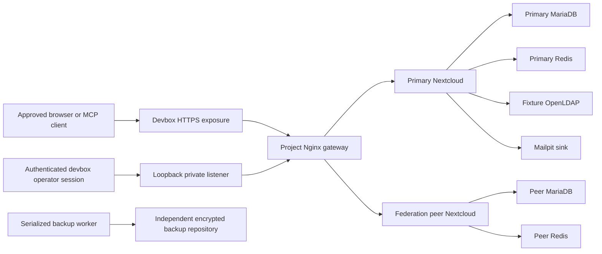

<!-- SPDX-FileCopyrightText: 2026 MCP for Nextcloud contributors -->
<!-- SPDX-License-Identifier: AGPL-3.0-or-later -->

# Upstream 1.1.0 isolated devbox provisioning proposal

**Status: target/resource ceilings and owner accepted; remaining design pending, not provisioned.**
This document makes the S0 starting option concrete. It creates no services, accounts, secrets, DNS records,
backup repository, exposure or deployment configuration. S0 remains partial and
all human reviewers remain unassigned. The user now accepts the resource ceilings
and operation/recovery responsibility. Recovery objectives and other unresolved
values remain proposals. No capacity reservation or execution is authorized; see
[confirmed decisions](2026-10-18-upstream-1.1.0-staging-acceptance-report.md#confirmed-decisions--short-validation-campaign).

**Goal:** provide an isolated environment for a bounded validation campaign on the
existing devbox, preserving state between required test sessions. Use synthetic
data and the qualified package to prepare the fork/upstream contribution, protect
other projects and keep production readiness as a separate decision.

**Inputs:** [S0 report](2026-10-18-upstream-1.1.0-staging-acceptance-report.md),
[acceptance phases S0–S7](2026-10-18-upstream-1.1.0-staging-acceptance.md) and
[human checklist](2026-10-18-upstream-1.1.0-human-review-checklist.md).
This is a provisioning design, not a replacement for their security scenarios or
an executable deployment recipe. The subsequent
[reviewed recipe record](2026-10-18-upstream-1.1.0-staging-provisioning-recipe.md)
implements the proposed design as inactive templates; neither document authorizes
provisioning.

## 1. Proposed baseline and immutable inputs

| Decision | Proposed value |
| --- | --- |
| Placement | Existing shared devbox; dedicated Docker Compose project `mcp-staging-110` |
| Origin | Fresh installation; no production backup or existing account import |
| Primary host | Nextcloud 35.0.1 Apache, pinned matrix digest |
| Database | Dedicated MariaDB 10.11.19, pinned matrix digest; no PostgreSQL in this topology |
| App | Frozen MCP 1.1.0 archive, code `7d8873cafaaadedc479c2204c9ef75bb76062dcf` |
| Cache/locking | Dedicated Redis per Nextcloud; APCu local cache where supported by the pinned image |
| Scheduler | Host-managed, project-specific timer every five minutes, running Nextcloud cron as the HTTP user inside the app container |
| Entry point | Dedicated Nginx gateway; all host HTTP binds on `127.0.0.1`; HTTPS exposure only for approved test windows |
| Test scale | At most ten synthetic users and two concurrent interactive testers; no performance certification |
| Lifetime | Short validation campaign, only as long as needed to collect evidence for the fork/upstream contribution; replaces the initial 30-day proposal. Close access between sessions; agree schedule/state retention before execution. No automatic deletion. |

Use the Nextcloud/MariaDB digests in the
[native matrix](../../../../mcp/tests/Integration/ci/matrix.json), not moving tags.
The archive SHA-256 is
`5eaf563d5d26f52d60f1bc81fb6a220043811838ab36d98403d02e05613fa01e`, preserved at
`mcp/build/verification/upstream-1.1.0-staging-s0/mcp-1.1.0.tar.gz`.
Verify it before copying only that artifact into the target. No checkout, `.git`,
Docker socket or host home directory is mounted into application containers.

The S0 snapshot observed cached exact images; availability must be checked again.
The host PHP version does not define the Nextcloud container's PHP version. Record
its actual runtime after authorized startup and compare with the qualified image.
This topology is a test baseline; no future production topology has been supplied.

### Auxiliary inputs and subsequent pinning

Select Redis, Nginx, Mailpit, an OpenLDAP fixture image and the restic worker image from
their maintained distribution channels, recording exact version, immutable digest
or checksum, provenance and required license notices before provisioning. These
products were unpinned when this proposal was reviewed. The subsequent
[recipe and input record](2026-10-18-upstream-1.1.0-staging-provisioning-recipe.md)
now freezes exact versions/digests and app checksums. Runtime compatibility and
security acceptance remain pending; no image is claimed cached merely because
Docker is available. Do not use `latest`.
Record a vulnerability/advisory review for all selected images and apps before
public exposure, including the already qualified Nextcloud/MariaDB pins. A frozen
pin proves identity, not absence of vulnerabilities. A required version change
returns to the acceptance plan's candidate-change gates; never silently update the
qualified candidate. No registry download or installation occurs in this proposal.

For NC35, the existing harness pins Group folders 23.0.1, Talk 25.0.6, Notes 6.0.2
and Calendar 6.6.2 with release checksums in
[`pin_releases`](../../../../mcp/tests/Integration/ci/harness.sh). Reuse those pins
where applicable. The subsequent recipe ledger fixes Deck, Contacts and Tasks UI
releases and checksums, which are not supplied by that pin function. Use those
reviewed inputs; runtime and signature acceptance remain pending.
Enable the required bundled Versions, Deleted files, external storage, DAV and
LDAP integration components. A missing required app blocks its acceptance row;
it must not be treated as a skipped test.

## 2. Topology and trust boundaries

The peer is a second, independently configured Nextcloud with its own database,
cache, credentials, data volume and canonical hostname. It runs only during F4
preparation/tests and its own backup tasks. It does not share the primary's MCP
policy, admin account or database. Use valid HTTPS exposure for each federation
origin during an approved window, not disabled certificate checks or a global
relaxation of private-address protections. If the real federation path cannot
operate under these constraints, F4 stays blocked pending a reviewed network plan.

Proposed networks:

- `mcp-staging-110-front`: gateway and application services only; no database.
- `mcp-staging-110-primary-data`: internal network for primary app, DB, Redis,
  LDAP and SMTP sink; the app also joins the front network for required egress.
- `mcp-staging-110-peer-data`: separate internal peer app/DB/Redis network.

Choose non-overlapping subnets at preflight using host routes and Docker IPAM;
never hard-code an assumed-free subnet or change the shared daemon's address pools.
The [S0 follow-up](2026-10-18-upstream-1.1.0-staging-acceptance-report.md#non-deployment-s0-follow-up)
found that all four `172.30.110.0/24`–`172.30.113.0/24` recipe fixture subnets
collide with existing Docker IPAM and host routing. They are syntax fixtures only,
not deployable allocations; the follow-up records unallocated alternatives.
Publish only gateway listeners and the loopback-only mail inspection interface.
Application, database, cache, LDAP and SMTP ports have no host publication. Docker
internal networks isolate those backend connections; the front bridge is **not**
an outbound-domain firewall. Record approved outbound purposes (CIMD, package
provisioning, federation and backup) and any required operator egress controls;
do not claim an allowlist that has not been enforced/tested.

The backup worker uses a separate project egress network with no database or
application endpoints, no inbound listener and no Docker socket. Mount only the
selected quiescent source volumes read-only, its private writable spool and the
required secret files. Restore is a separate operator action with explicitly
selected replacement volumes, never writable mounts of the live originals.

Every container/network/volume receives project, environment and ownership labels.
No external Compose networks or pre-existing volumes are reused. The boundary
assumes trusted devbox administrators: host root and Docker administrators can
access container data. This does not provide hostile-tenant isolation.

## 3. Resource allocation and stop conditions

Use Compose service-level CPU and memory limits and verify the resulting runtime
settings; a YAML declaration alone is not proof of enforcement. The following
limits are a proposed small acceptance workload, not Nextcloud sizing guidance.
[Docker's service reference](https://docs.docker.com/reference/compose-file/services/)
describes these controls and explicit host-port bindings.

| Service | CPU ceiling | Memory ceiling (MiB) | Mode |
| --- | ---: | ---: | --- |
| Primary Nextcloud, including cron executions | 2.00 | 3072 | Core |
| Primary MariaDB | 0.75 | 1280 | Core |
| Primary Redis | 0.25 | 256 | Core |
| Nginx gateway | 0.25 | 128 | Core |
| Mailpit sink | 0.25 | 128 | Core |
| OpenLDAP fixture | 0.25 | 256 | F1 preparation/testing |
| Peer Nextcloud, including cron | 1.50 | 2048 | Federation window |
| Peer MariaDB | 0.50 | 768 | Federation window |
| Peer Redis | 0.25 | 128 | Federation window |
| Backup worker | 0.50 | 512 | Runs only with peer services stopped |

Core plus LDAP: **3.75 CPUs / 5120 MiB**. With the peer: **6 CPUs / 8064 MiB**.
Core plus LDAP and backup, peer stopped: **4.25 CPUs / 5632 MiB**. Do not run backup/restore,
full PHP/browser/native qualification or another staging copy concurrently with
the full federation profile. A recovery target may have separate volumes, but
stop the original app/DB before starting their restored replacements.

S0 observed 8 logical CPUs, approximately 15.6 GiB total RAM and 135 GiB free disk.
Before startup, require at least **10 GiB available RAM and 120 GiB free disk**, and
obtain the shared-host owner's allocation. The 120 GiB threshold applies before
initial allocation; on later starts verify remaining budget plus the 50 GiB reserve
without counting already allocated staging bytes twice. These are admission thresholds;
S0's snapshot is not current capacity approval. Keep at least 50 GiB disk headroom
for other workloads. If memory falls below 3 GiB available, storage falls below
that headroom or the host swaps persistently, pause new test work, close any test
window and ask the operator to reallocate; never evict another project's services.
An OOM or failed dependency is a failed test/environment incident, not a retry to hide.

| Local disk budget | Maximum working allowance |
| --- | ---: |
| Primary persistent state, including DB/data/apps/logs | 20 GiB |
| Peer persistent state | 6 GiB |
| Auxiliary state/logs | 2 GiB |
| Consistent backup spool | 12 GiB |
| Temporary primary restore volumes | 20 GiB |
| Additional images/build overhead | 10 GiB |
| Total incremental allowance | **70 GiB**, plus the 50 GiB host reserve |

Limit synthetic file payloads to 8 GiB on the primary and 1 GiB on the peer; watch
versions/trash/SQL growth as part of their total budget. Limit container logs to
three 10 MiB files per service and retain sanitized acceptance evidence separately.
These disk figures are monitored budgets, **not** filesystem quotas supplied by
Compose. Alert at 80% of any allowance and stop writes before exhaustion. A backup
that will exceed its spool budget blocks the operation; do not assume compression
will make it fit. A peer restore needs a separate capacity assessment; the 20 GiB
restore allowance is for the primary only. Never use global Docker pruning.

## 4. Runtime state, credentials and scheduler

Proposed host-side locations, to be created only after authorization:

- `/home/dev/.config/mcp-for-nextcloud-staging/upstream-1.1.0/`: rendered Compose
  and gateway configuration, immutable input ledger and secret files.
- `/home/dev/.local/state/mcp-for-nextcloud-staging/upstream-1.1.0/`: private backup
  spool, runtime IDs, exposure lifecycle and operator logs.
- Docker-owned, project-labeled named volumes: separate Nextcloud installation,
  config/custom apps/data, database and fixture storage for each instance.

These are project deployment locations, not devbox-harness profiles. Do not edit
existing harness state/bindings or put runtime metadata inside the Git repository.
Keep language/package caches in standard per-user locations, not `/tmp`.

Use fresh, distinct database/admin/Redis/LDAP credentials per instance and fixture.
Host secret directories use mode `0700` and host secret files `0600`, with narrowly
reviewed read permissions for each required container UID. Keep them outside Git
and never pass their values in command arguments or reports. Use supported image
`_FILE` mechanisms or mounted private configuration; do not claim Compose secrets encrypt their host source files.
Nextcloud writes sensitive settings into its config volume, which belongs in the
encrypted backup scope. The [Nextcloud Docker documentation](https://github.com/nextcloud/docker)
describes supported secret-file variables; verify them against each pinned image.

Run cron every five minutes through a named project timer using the existing app
container, as the HTTP user, with the same PHP/config/cache context as web requests.
A lock prevents overlapping cron/backup/recovery work; missed or failed runs remain
visible. Pause the timer before snapshots or restore and resume only after checks.
Select the Nextcloud cron background-job mode, verify actual completion, and check
both MCP policy jobs. Do not mount a Docker socket into a cron container or install
an unscoped system-wide scheduler. Host timer/service definitions and their
privileges require review during the later provisioning implementation.

Configure project gateway/app/job logs to omit Authorization/Cookie headers,
OAuth codes, tokens, client secrets and full query strings. Disable debug request
body/header dumps; redact any selected acceptance traces before retention. Treat
Mailpit contents and raw backups as private even when identities are synthetic.
Verify this with non-secret disposable markers before any credential-bearing HTTP
test, including private OAuth and recovery controls. Cover vendor error logs as well
as access logs, and confirm equivalent handling at the HTTPS exposure layer before
traffic uses it. The recipe does not implement vendor error-log or exposure-layer
redaction. Unverified handling blocks the affected traffic; retain diagnosable errors
without credential leakage rather than suppressing errors to pass the gate.

## 5. Access modes and external test windows

Proposed ports, subject to a collision check before allocation:

| Host listener | Purpose | Exposure rule |
| --- | --- | --- |
| `127.0.0.1:18080` | Private primary administration/probes via gateway | Never publish as an unauthenticated preview |
| `127.0.0.1:18081` | Primary real-client review window | Default deny; expose only with explicit authorization |
| `127.0.0.1:18082` | Peer federation window | Default deny; separate exposure and hostname |
| `127.0.0.1:18083` | Mailpit message inspection | Local operator only; never public |

If any port is occupied, allocate another free loopback port and update the
manifest; do not stop its owner. The private listener is reached through the
existing authenticated devbox operator session. Loopback itself does not distinguish
trusted users on this shared host. No additional user-run terminal preparation is
required; an authorized agent/operator performs host operations. Private human
browser access needs a separately reviewed authenticated tunnel/access method and
is not assumed available. Separate private and public gateway ports must also use
distinct container listeners, not several host mappings to a shared virtual-host
listener. Requests on a public socket must never select the private route by Host,
forwarded headers or URL. Reject unknown hosts and exercise those negative controls
on both public sockets in S1, including while Nextcloud maintenance is off. Confirm
that peer/mail interfaces and direct backend ports cannot be reached externally
while the public gateways are closed.

### Closed mode — default and after every test window

Public listeners deny requests before they reach Nextcloud. No preview exists or
any previous exposure has been revoked. Host-side administrative controls remain
available via the private path. Credentials and ordinary app policy are not toggled
merely to close the gateway; routine isolation must not revoke valid connections.

### Review mode — explicit, time-bounded authorization

Propose a **two-hour window** per client/federation session. After authorization,
the operator uses the existing devbox preview facility on the selected loopback
listener and records its actual returned HTTPS URL/exposure ID and expiry. No
hostname is invented in this proposal. Renew only within the approved window;
revoke at its end or when the server stops. Do not rely on the service's lease as
the primary cleanup control. The later recipe must enforce an independent,
operator-reviewed deadline that closes the public gateway even if the interactive
session disappears, and start/restart in closed mode. Record and test expiry,
revocation failure and restart behavior before opening a window; a failed revocation
must leave ingress denied and be reported for follow-up, not treated as cleanup.

Keep one canonical HTTPS origin per instance for the session. Configure explicit
trusted domains and proxy addresses, scheme/host/CLI URL and appropriate streaming
timeouts; strip/rebuild untrusted forwarded headers at the project gateway.
Preserve Authorization headers to Nextcloud. No extra HTTP Basic gate may mask
OAuth or Nextcloud app-password behavior during actual-client tests. Retain native
login, consent, CSRF, rate/brute-force protection and TLS verification. The
[Nextcloud proxy guide](https://docs.nextcloud.com/server/stable/admin_manual/configuration_server/reverse_proxy_configuration.html)
explains the trust boundary; use only observed proxy addresses, never all private
networks. If exposure changes the canonical origin, stop and repeat discovery,
redirect and consent evidence for that new origin.

Only synthetic identities/content may leave through approved clients or federation.
The public window intentionally exercises real Nextcloud authentication and is
not an operator-only maintenance channel. Confirm external reachability and client
account capabilities before claiming S3/F4; an installed server cannot supply those.

### Recovery mode — independent barrier before maintenance is lifted

Close both public listeners and revoke their exposures, drain in-flight requests,
stop schedulers and verify denial from outside the private operator path. Then
apply maintenance and the S6 recovery procedure. If later private HTTP controls
require maintenance off, the independently tested barrier remains closed. Run
old/new credential controls through the private route using the recorded canonical
Host/issuer configuration; do not interpret a firewall/maintenance refusal as
revocation. End with MCP closed, test access withdrawn and the operator record saved.

## 6. Backups, retention and recovery objectives

**Proposed backup mechanism:** restic, pinned and verified before installation,
writing to a dedicated encrypted repository on an operator-selected S3-compatible
service **outside this devbox and its disk**. No provider, bucket, account, billing
or credentials exists yet. Selecting a destination and approving any cost are
prerequisites; no service signup or repository initialization is authorized here.
The [restic repository guide](https://restic.readthedocs.io/en/stable/030_preparing_a_new_repo.html)
describes encrypted repositories and supported remote backends.

Proposed schedule: **every 12 hours, at 00:00 and 12:00 UTC**, plus before any
update, policy-destructive acceptance test or recovery rehearsal. A once-daily
local-time job can exceed a 24-hour RPO because of daylight-saving changes or job
duration. Record actual UTC start, recovery-point and verification times; serialize
runs, alert on a failed/missed job or a verified recovery point older than 18 hours,
and block new test writes if its age reaches 24 hours. Notification destination
and monitoring owner remain pending. Measure backup duration in S1 and adjust the
approved cadence if there is insufficient margin. A pre-change snapshot must be
completed and verified off-host before the change starts; a local spool is not a
completed backup.

Proposed targets for the bounded primary dataset:

- **RPO: 24 hours** for routine fixture changes; no loss of the approved pre-change
  baseline for a planned destructive operation. Measure against the recovery
  point of the latest verified remote snapshot, not its upload completion
  time or the last attempted job. Compare a private inventory of fixture content,
  versions and ACLs at quiescence with the restored state to quantify actual loss.
- **RTO: 90 minutes**, from the operator declaring the isolated restore exercise
  started until the restored primary passes integrity, old-credential refusal,
  fresh reconnection and scope checks on the private route. Public reopening is
  outside this measurement and needs its own decision.
- These are targets for human/operator agreement and later S6 measurement, not
  guarantees. Failure to meet them blocks their acceptance; adjust only through
  an explicit reviewed decision, never by editing a result after the run.

### Consistent backup contents and sequence

Close the test window, pause cron/background writers, enter maintenance and verify
quiescence before copying. Capture config, custom apps, synthetic data, themes,
external-mount fixture content and a consistent MariaDB logical dump, together with
the app archive, exact image digests, non-secret configuration inventory and phase
state. Include the rendered deployment/gateway/timer configuration and required
runtime secrets in the encrypted backup; only a redacted inventory belongs in the
report. Include a consistent LDAP configuration/directory export preserving fixture
identifiers, groups and memberships, plus its recovery credentials. Pause LDAP
mutations while capturing the coordinated checkpoint. Choose and verify the
image-supported export/import procedure before S1 closes; if the recovered group
backend cannot reproduce authorization state, recovery remains blocked.
Keep passwords out of dump command arguments. Do not copy live raw database
files as a substitute for a consistent dump. Nextcloud's
[backup guide](https://docs.nextcloud.com/server/stable/admin_manual/maintenance/backup.html)
identifies the related state that must be preserved together.

Store the coordinated snapshot in the private spool and upload it encrypted to the
remote repository. Check success and snapshot identity, then run the pinned
restic equivalent of `check --read-data` to read and validate stored data before
releasing the lock/maintenance or proceeding with a destructive action. A metadata
check alone is insufficient; include this work in the measured backup duration and
resource limits. Repository integrity does not prove application recovery: S1 also
reads back its baseline and S6 performs the coordinated application restore. The
[restic integrity guide](https://restic.readthedocs.io/en/stable/045_working_with_repos.html)
distinguishes repository structure checks from reading stored data. Preserve
remote snapshot IDs and timestamps, not raw SQL or secrets, in the acceptance report.
Failure leaves the change blocked; the operator may explicitly abort maintenance
without performing the intended destructive step. Backup operations must not
change MCP policy just to quiesce ordinary traffic.

Back up each instance with its own identity/tag. For F4, quiesce both sides during
a coordinated fixture checkpoint and record the paired snapshot IDs. Produce the
logical dumps within the database containers' existing limits, then stop peer
services before starting the backup worker to copy the quiescent files and upload
the paired checkpoint. This preserves the resource envelope without dumping a
stopped database. Keep both instances quiescent until the checkpoint is complete.
The primary RTO target does not certify full federation disaster recovery.

### Retention, keys and restore proof

Propose seven daily, four weekly and two monthly snapshots, plus the specifically
identified pre-change/recovery snapshots until their acceptance evidence is closed.
Use per-instance grouping and explicit protection of those named snapshots; do
not assume daily/weekly rules retain a particular recovery baseline. Preview any
forget/prune operation and require operator approval of its exact scope. Restic's
[retention documentation](https://restic.readthedocs.io/en/stable/060_forget.html)
explains snapshot selection; no pruning runs as part of this proposal.

Keep a recoverable copy of the repository password and access instructions in an
operator-approved secret store independent of the devbox. The application receives
no backup credentials. Restrict repository credentials to the dedicated namespace;
review actual provider permissions and any separate pruning credentials rather
than claiming an unverified append-only or immutable policy. A bucket on this host,
a second directory or an unreadable encrypted archive does not satisfy recovery.

S6 restores into clearly identified replacement volumes while the original app/DB
remain stopped; preserve originals until verification/disposition. Recreate the
same application image and config/data/database set, restore the matched LDAP and
external-mount fixture state before testing authorization, reset ephemeral caches
and apply the existing S6 credential-cut procedure **before any public reopening**.
This includes native app-password handling and expiry-aware OAuth controls. Follow
[Nextcloud restore guidance](https://docs.nextcloud.com/server/stable/admin_manual/maintenance/restore.html)
for matching state; do not perform a file-only downgrade. Restore proof, measured
RPO/RTO acceptance and proof remain pending. The user has accepted the backup/recovery role; destination, custody and operating arrangements remain unresolved.

## 7. Proposed provisioning sequence and acceptance gates

These steps are for a later authorized implementation. None is checked complete.

1. **Freeze decisions:** approve origin, resource allocation, paths, ports, all image
   and app pins, backup destination/targets and named operational ownership. Confirm
   all S0 people/client requirements. Missing prerequisites retain S0 partial
   status and block S1; documentation-only recipe review may continue.
2. **Prepare a reviewable recipe:** render Compose, gateway mode switches, private
   configuration, cron/backup timers and a per-resource manifest outside the repo.
   Validate syntax and resource/port/mount plans before executing them. Keep this
   separate from the disposable native test runner; introduce no runtime app bypass.
3. **Provision S1 foundations:** after authorization, create only the recorded
   project resources and synthetic fixtures. Verify limits, internal reachability,
   no unplanned public bind, private admin access and mail capture. Leave public
   gateways closed. A missing optional app needed by a test is a blocker.
4. **Close S1 with recovery capability:** initialize the separately authorized
   remote backup repository, create a consistent off-host baseline of the fresh
   Nextcloud fixtures and prove access to keys/data and backup readability before
   installing MCP. This preparatory baseline is not the S6 recovery verdict.
5. **Install S2 candidate:** transfer and verify the frozen archive, follow the
   existing S2 install/default-state checks, configure supported controls and
   demonstrate scheduler/job completion. Capture actual deployed versions/hashes
   and a new consistent baseline before subsequent destructive tests.
6. **Run authorized acceptance windows:** execute S3–S5 in order with the assigned
   humans/clients, then S6 with the backup operator. Use the existing scenario IDs,
   not a new reduced test suite. Stop on dependent failures and retain evidence.
7. **Close the window and report:** revoke exposure, stop unneeded peers, preserve
   evidence, and apply S7 final-candidate/human approval rules. Resource deletion,
   backup pruning and production rollout are separate, explicitly scoped actions.

The recovery destination/design must be approved before S1; before any destructive
acceptance operation, the relevant consistent remote snapshot must already exist.
The implementation must order its baseline backup ahead of that operation even
if it appears earlier in a broader acceptance phase.

## 8. Decisions still required and human review

| Outstanding decision | Proposed default / remaining requirement |
| --- | --- |
| Host/origin/capacity | Fresh devbox target and resource ceilings accepted by its owner, the requesting user; capacity recheck, network/ports and execution authority remain pending. |
| Auxiliary releases | Exact Redis/Nginx/Mailpit/OpenLDAP/restic and Deck/Contacts/Tasks inputs are recorded in the subsequent recipe; advisory, runtime and operator acceptance remain pending. |
| Canonical access | Loopback ports above; actual HTTPS names and exposure lifecycle available only after authorized provisioning/exposure. |
| Backup provider and keys | User accepts recovery responsibility; independent remote destination, provider/account arrangements, credentials, costs, password custody and alert delivery remain pending. |
| RPO/RTO and retention | Proposed 24 hours / 90 minutes and 7 daily / 4 weekly / 2 monthly; operator approval and proof pending. |
| Operators/security reviewers | Requesting user accepts operation/recovery. Security reviewers and final approver remain unassigned; no review verdict is implied. |
| Languages/accessibility | All 96 document reviews, four runtime languages including German additions, and assistive-technology review remain pending. |
| Real clients/federation | Actual client accounts/devices/features, human tester and partner configuration remain unconfirmed. |
| Production comparison | None supplied; acceptance can describe only this chosen staging topology. |

A competent person may cover several roles, but automated assistance cannot supply
human approval. This proposal does not close S0, alter the checklist or approve an
external account/cost. The next decision is review of this concrete design and its
unresolved inputs; deployment and push remain outside the current request.

The shorter lifetime does not require waiting for daily/weekly/monthly retention
buckets to fill. Those backup targets remain an unapproved starting proposal;
review the [campaign recovery proposal](2026-10-18-short-campaign-recovery.md)
separately without waiving pre-change checkpoints or independent recovery evidence.
Its event-based checkpoints and seven-day review buffer are unaccepted alternatives,
not active changes to the recipe. No provider, payment or cleanup is authorized.

## 9. Proposal review and documentation verification — historical checks

The documentation review corrected the backup cadence/RPO comparison, included
LDAP and private deployment state in recovery, and made listener isolation,
window expiry and secret-safe logging explicit acceptance requirements. It also
clarified backup-worker privileges and capacity accounting. These are reviewed
design requirements, not evidence that the controls work on a running server.
Human assignments and every S1–S7 execution/approval remain pending.

This English development proposal is excluded from the operational package. Validate
it with `composer --working-dir=mcp docs:check`, `docs:translations`, `test:docs` and
`git diff --check`; retain the existing 96 pending review states. These commands
cannot validate Docker sizing, backup objectives or real network behavior.
The linked primary references were consulted on 2026-10-18; immutable repository
pins remain the candidate authority, and implementation must recheck auxiliary
release compatibility before provisioning.

Initial proposal checks on 2026-10-18: `docs:check` passed for 178 Markdown
files and 110 package sources; `docs:translations` retained 96 `review-required`
states; all 29 `test:docs` tests passed. The initial sandboxed test attempt failed
because its worktree build directory was read-only (`EROFS`); the same canonical
command passed with authorized worktree write access, without test/code changes.
No provisioning, capacity reservation, public exposure or recovery test was run.

After the proposal review, the same three documentation commands passed again
with 178 Markdown files, 110 package sources, 96 pending human translation reviews
and 29 tests passing without skips. The staged diff also passed its whitespace
check before commit.
No application or package source was changed; the frozen candidate is unchanged.
